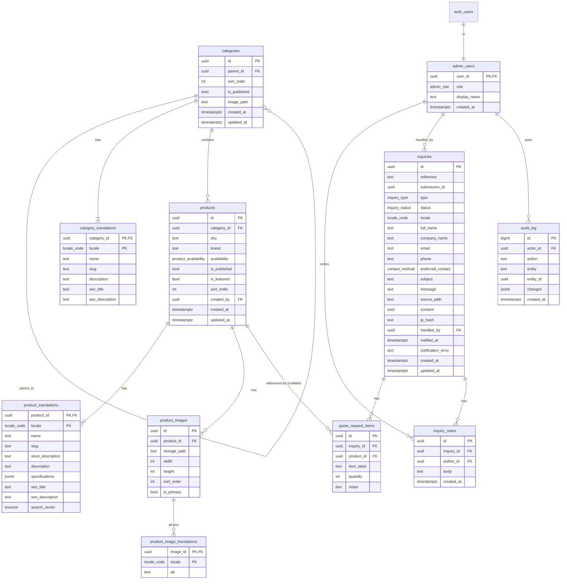

# Database Schema (Supabase Postgres)

_Status: proposed design. **No migration has been written or applied.** SQL below is a design reference for Phase 3/5; it will be turned into reviewed files under `supabase/migrations/`._

## 1. Entity-relationship diagram



## 2. Enums
| Enum | Values |
|---|---|
| `locale_code` | `fr`, `ar`, `en` |
| `product_availability` | `in_stock`, `on_order`, `out_of_stock`, `discontinued` |
| `inquiry_type` | `contact`, `quote` |
| `inquiry_status` | `new`, `in_progress`, `answered`, `closed`, `spam` |
| `contact_method` | `email`, `phone`, `whatsapp` |
| `admin_role` | `owner`, `editor` |

Availability labels are final only after MSLAB confirms the vocabulary.

## 3. Tables, constraints, indexes

### Catalog
| Table | Key constraints | Indexes |
|---|---|---|
| `categories` | `parent_id → categories(id) ON DELETE RESTRICT`; `CHECK (parent_id <> id)`; depth ≤ 2 enforced by trigger | `parent_id`, `(is_published, sort_order)` |
| `category_translations` | PK `(category_id, locale)`; `category_id ON DELETE CASCADE`; `UNIQUE (locale, slug)`; `CHECK slug ~ '^[a-z0-9]+(-[a-z0-9]+)*$'`; `name` 1–120 chars | `(locale, slug)` |
| `products` | `category_id → categories ON DELETE RESTRICT`; `UNIQUE (sku)` where not null; `created_by → auth.users ON DELETE SET NULL` | `category_id`, `(is_published, is_featured)`, `brand` |
| `product_translations` | PK `(product_id, locale)`; `ON DELETE CASCADE`; `UNIQUE (locale, slug)`; slug check; `name` 1–200; `description` ≤ 10 000; `search_vector` generated: `to_tsvector('simple', coalesce(name,'') || ' ' || coalesce(short_description,'') || ' ' || coalesce(description,''))` | `(locale, slug)`; GIN `search_vector`; GIN `name gin_trgm_ops` |
| `product_images` | `product_id ON DELETE CASCADE`; `UNIQUE (storage_path)`; `CHECK width > 0 AND height > 0`; partial `UNIQUE (product_id) WHERE is_primary` | `(product_id, sort_order)` |
| `product_image_translations` | PK `(image_id, locale)`; `ON DELETE CASCADE`; `alt` ≤ 250 | — |

`specifications` is a JSON array of `{label, value}` objects (validated by Zod; `CHECK jsonb_typeof(specifications) = 'array'`).

### Inquiries
| Table | Key constraints | Indexes |
|---|---|---|
| `inquiries` | `reference` unique, generated `MS-YYYY-NNNNNN` from a sequence; `submission_id` unique (idempotency); `consent = true` CHECK; `email` or `phone` required CHECK; lengths: name ≤ 120, company ≤ 160, subject ≤ 200, message ≤ 5 000; `handled_by → admin_users ON DELETE SET NULL` | `(status, created_at desc)`, `(ip_hash, created_at)`, `type` |
| `quote_request_items` | `inquiry_id ON DELETE CASCADE`; `product_id ON DELETE SET NULL`; `item_label` 1–200 (snapshot of product name or free text); `quantity BETWEEN 1 AND 1000000` | `inquiry_id`, `product_id` |
| `inquiry_notes` | `inquiry_id ON DELETE CASCADE`; `author_id → admin_users ON DELETE SET NULL`; body 1–5 000 | `inquiry_id` |

### Administration
| Table | Key constraints |
|---|---|
| `admin_users` | `user_id → auth.users ON DELETE CASCADE`; role default `editor` |
| `audit_log` | append-only (no update/delete policies); written by triggers on catalog and inquiry status changes |

All mutable tables: `created_at default now()`, `updated_at` maintained by a shared `set_updated_at()` trigger.

## 4. Functions
```sql
-- Admin check used by every admin policy
create function public.is_admin() returns boolean
language sql stable security definer set search_path = ''
as $$ select exists (select 1 from public.admin_users where user_id = auth.uid()) $$;

-- Owner check for managing admin_users
create function public.is_owner() returns boolean ... -- same pattern, role = 'owner'

-- Public inquiry entry point (granted to anon, authenticated)
create function public.submit_inquiry(payload jsonb) returns table (id uuid, reference text)
language plpgsql security definer set search_path = ''
-- 1. validate required fields & lengths (defense in depth after Zod)
-- 2. rate limit: count inquiries with same ip_hash in last 10 min (> 5 → raise 'rate_limited')
-- 3. idempotency: return existing row if submission_id already exists
-- 4. insert inquiry + items in one transaction; items with product_id must reference a published product
-- 5. return id, reference

-- Public search (RLS applies)
create function public.search_products(p_locale public.locale_code, p_query text,
  p_category uuid, p_availability public.product_availability, p_limit int, p_offset int)
returns setof ... language sql stable security invoker set search_path = '';
```

## 5. Row Level Security policies
RLS **enabled on every table**. Default: no access.

| Table | anon | authenticated (non-admin) | admin (`is_admin()`) |
|---|---|---|---|
| `categories` | SELECT where `is_published` | same as anon | ALL |
| `category_translations` | SELECT where parent category published | same | ALL |
| `products` | SELECT where `is_published` and category published | same | ALL |
| `product_translations` | SELECT where product visible | same | ALL |
| `product_images` (+ translations) | SELECT where product visible | same | ALL |
| `inquiries` | — (insert only through `submit_inquiry`) | — | SELECT, UPDATE (status, handled_by); DELETE only `is_owner()` |
| `quote_request_items` | — | — | SELECT |
| `inquiry_notes` | — | — | SELECT, INSERT (`author_id = auth.uid()`), UPDATE/DELETE own |
| `admin_users` | — | SELECT own row | SELECT all; INSERT/UPDATE/DELETE only `is_owner()` |
| `audit_log` | — | — | SELECT (owner); INSERT via trigger only |

Policies are written per command (`for select`, `for insert` …) with `to anon, authenticated` or `to authenticated` explicitly, and wrap `auth.uid()` / `is_admin()` as `(select public.is_admin())` for planner caching.

### Storage policies (`storage.objects`)
| Bucket | Read | Write/Update/Delete |
|---|---|---|
| `catalog` (public) | public URL | `bucket_id = 'catalog' and (select public.is_admin())` |
| `inquiry-attachments` (future, private) | admin only | insert via server-issued signed upload URL |

## 6. Extensions
`pg_trgm` (fuzzy search, Arabic-friendly), `unaccent` (optional, query-side only — not usable in generated columns because it is not immutable).

## 7. Open schema questions
- Category depth (2 levels assumed) and whether products can belong to several categories (assumed: one).
- Brands as free text vs a `brands` table (free text for v1).
- Books: need ISBN/author/publisher fields? (add `product_attributes` or book-specific columns once MSLAB confirms).
- Printing services as quote "items" with options (format, paper, quantity tiers) — later phase.
- Retention period for inquiries (Loi 09-08) → purge job.
- Arabic slugs: Latin transliteration (assumed) vs Arabic script.
