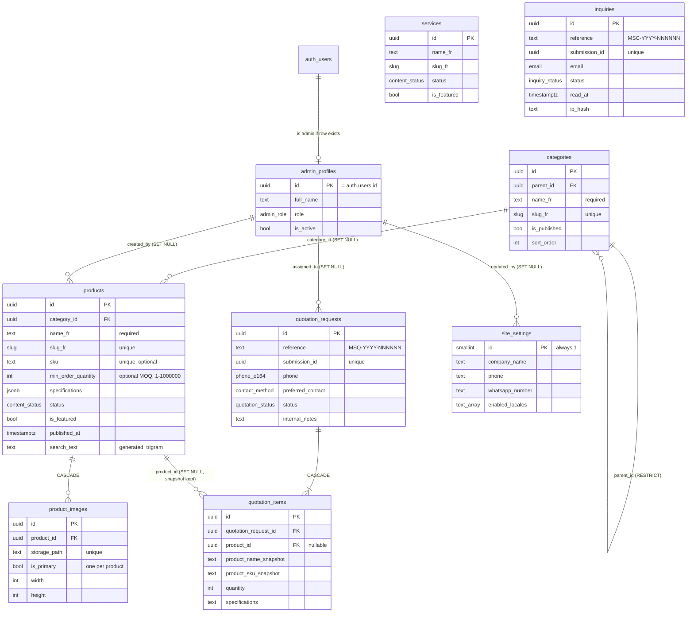

# Database Schema (Supabase Postgres)

_Status: **implemented in Milestone 2** and applied to the `mslab-dev` project (`xccgcoznshndfquwsuwq`, eu-west-3). Production has **no** schema yet — migrations are applied there only with explicit approval._

Source of truth: `supabase/migrations/*.sql`. Decisions: ADR-009 → ADR-014 in `SYSTEM_ARCHITECTURE.md`.

## 1. Entity-relationship diagram

Localized content (ADR-010): every translatable field exists as `<field>_fr` (required where the field is required), `<field>_ar`, `<field>_en` (optional). Public reads fall back to French. Each locale has its own unique slug (`slug_fr` required; `slug_ar`/`slug_en` optional, allowed only when that locale's name exists).

## 2. Types and domains
| Name | Definition |
|---|---|
| `content_status` | `draft`, `published`, `archived` (products, services) |
| `quotation_status` | `new`, `in_review`, `contacted`, `quoted`, `accepted`, `rejected`, `closed` |
| `inquiry_status` | `new`, `read`, `replied`, `closed`, `spam` |
| `contact_method` | `email`, `phone`, `whatsapp` |
| `admin_role` | `owner`, `editor` |
| `slug` | `^[a-z0-9]+(-[a-z0-9]+)*$`, ≤ 120 chars |
| `email_address` | basic `x@y.z` shape, ≤ 254 chars |
| `phone_e164` | `^\+[1-9][0-9]{6,14}$` (server normalizes Moroccan formats first) |
| `locale_code` | `fr`, `ar`, `en` |

## 3. Tables
| Table | Purpose | Key constraints & deletion behavior |
|---|---|---|
| `admin_profiles` | Back-office users | PK = `auth.users.id` (CASCADE). Membership never derived from user metadata |
| `categories` | Catalog tree | `parent_id` RESTRICT (can't delete a parent with children); no self-parent; text length checks |
| `products` | Catalog items, **no prices, no availability** (ADR-007/011) | `category_id` SET NULL; unique slugs/SKU; `specifications` must be a JSON array; `published_at` set by trigger on first publish |
| `product_images` | Images in Storage bucket `catalog` | CASCADE with product; unique `storage_path`; partial unique index → max one `is_primary` per product |
| `services` | DB-managed services (ADR-012) | unique slugs; `status` lifecycle |
| `inquiries` | Contact form messages | `consent = true` required; unique `submission_id` (idempotency); `ip_hash` must be a SHA-256 hex (raw IP never stored); human reference `MSC-YYYY-NNNNNN` |
| `quotation_requests` | Quote headers | phone required (E.164); `status_changed_at` maintained by trigger; `internal_notes` admin-only; reference `MSQ-YYYY-NNNNNN` |
| `quotation_items` | Requested lines (1–50 per request) | CASCADE with request; `product_id` SET NULL on product deletion; **name + SKU snapshots** preserve history; `quantity` 1 – 1 000 000; no update/delete policies (immutable) |
| `site_settings` | Verified company facts (singleton `id = 1`) | every field optional (empty = hidden); `https://` URLs only; `enabled_locales` ⊆ {fr, ar, en} and always contains fr |
| `private.app_config` | Server configuration (not exposed via API) | holds `submission_key_sha256` |

All mutable tables have `created_at`/`updated_at` (trigger `set_updated_at`).

### Indexes
FKs (`categories.parent_id`, `products.category_id`, `products.created_by`, `quotation_items.*`, `quotation_requests.assigned_to`, `site_settings.updated_by`); listing (`products(status, is_featured, sort_order)`, `services(status, sort_order)`, `categories(is_published, sort_order)`); inbox (`inquiries(status, created_at desc)`, `quotation_requests(status, created_at desc)`); rate limiting (`(ip_hash, created_at)` on both submission tables); search (`products.search_text` GIN trigram).

## 4. Functions
| Function | Security | Callable by | Purpose |
|---|---|---|---|
| `private.is_admin()` / `private.is_owner()` | definer, `search_path=''` | used inside policies (not exposed via REST) | active admin / owner check |
| `private.check_submission_key(text)` | definer | nobody directly | compares SHA-256 of the server key with `private.app_config` |
| `public.submit_contact_inquiry(payload, submission_key)` | definer | anon, authenticated (**rejected without the server key**) | idempotent insert, 5 per `ip_hash` per 10 min |
| `public.submit_quotation_request(payload, submission_key)` | definer | same | atomic request + items; catalog items must be **published**; names/SKU read from DB (never trusted from client); custom items use a free-text label |
| `public.record_submission_notification(kind, reference, error_message, submission_key)` | definer | same (server key required) | writes `notified_at` / `notification_error` after the email step (M5) |
| `set_updated_at`, `products_set_published_at`, `quotation_requests_track_status` | invoker triggers | not callable via API | bookkeeping |

## 5. Row Level Security
RLS is enabled on every table. `anon` additionally has no INSERT/UPDATE/DELETE grants anywhere and no SELECT grant on customer tables.

| Table | anon | authenticated (not admin) | editor | owner |
|---|---|---|---|---|
| categories | read published | read published | all | all |
| products / services | read `published` | read `published` | all (incl. drafts) | all |
| product_images | read images of published products | same | all | all |
| inquiries | — | — | read, update | + delete |
| quotation_requests | — | — | read, update | + delete |
| quotation_items | — | — | read | read |
| admin_profiles | — | read own row | read all | insert/update/delete (not self-delete) |
| site_settings | read | read | update | update |

### Storage (`catalog` bucket)
Public bucket (objects served by public URL), 5 MB limit, MIME allowlist `jpeg/png/webp/avif` (no SVG). No public SELECT policy → files cannot be listed anonymously. Admins can upload/update/delete, uploads limited to the `products/`, `categories/`, `services/` folders.

### Verified behavior (Milestone 2)
- **24 SQL role-switching checks** (anon, signed-in non-admin, editor, owner), run inside a transaction that's rolled back: all passed — drafts hidden, no direct writes, wrong submission key rejected, editors can't self-promote or delete inquiries, owners can, storage folder restriction enforced.
- **11 HTTP integration tests** (`npm run test:integration`, publishable key): all passed — published-only reads, customer tables unreadable, contact + multi-item quotes (catalog + custom), idempotency, rate limit, draft product rejected atomically.
- Snapshot preservation verified: deleting a quoted product keeps its item with original name and SKU (`product_id` → null).
- Supabase advisors: no errors. Intentional remaining warnings: the two submission RPCs are callable by `anon` (guarded by the server key); `private.app_config` has RLS with no policies (no API access by design).

## 6. Seed strategy
| File | Use |
|---|---|
| `supabase/seed/initial_catalog.sql` | **Real content** (confirmed by MSLAB 2026-11-15): 3 categories, 5 products, names only (fr/ar/en). No descriptions, SKUs, specs, prices or stock until MSLAB adds them in the admin. Idempotent; replaced the former `exemple-*` sample data in place (same UUIDs). Applied to `mslab-dev`; run once on production at setup. |
| `supabase/seed/remove_sample_catalog.sql` | Removes all sample rows (quote snapshots survive). |
| `supabase/seed/remove_test_submissions.sql` | Removes rows created by integration tests. |

Production starts **empty**; real categories, products, services and settings are entered by MSLAB through the admin (Milestone 6).

## 7. Environment setup per project
1. Apply `supabase/migrations/*` in order.
2. Generate a 32-byte hex `FORM_SUBMISSION_KEY` and `IP_HASH_SALT` for the environment (server env vars).
3. Store `encode(sha256(FORM_SUBMISSION_KEY), 'hex')` in `private.app_config` (`key = 'submission_key_sha256'`). Only the hash lives in the database.
4. Auth settings (dashboard, owner action): **disable public sign-ups**, enable MFA, set site URL.
5. First owner: create the user in Supabase Auth (dashboard → Add user), then insert `admin_profiles (id, role) values ('<user id>', 'owner')` via SQL.

> Note: migrations were applied through the Supabase MCP, whose recorded migration versions differ from the local file timestamps. Before using the Supabase CLI against this project, run `supabase migration repair` to align history.

## 8. Open schema questions
- Book-specific fields (ISBN, author, publisher)? Can be added as nullable columns or `specifications` entries.
- Category depth: currently unlimited in the schema; the UI will assume ≤ 2 levels.
- Artwork uploads for print quotes (private bucket) — deferred.
- Inquiry retention period (Loi 09-08) → scheduled purge job.
- Arabic slugs: Latin (current assumption) vs Arabic script.

## 9. Print on demand (migration `20261115100000_print_on_demand.sql`)

| Object | Purpose | Access |
|---|---|---|
| `quotation_requests.kind` (`catalog` \| `custom`) | A print-on-demand request is a quotation request of kind `custom` | as before (admin only) |
| `quotation_status` + `in_production`, `ready`, `delivered` | Production stages for order tracking | — |
| `custom_request_details` (1:1) | Project type, description, quantity, dimensions + unit, material and finishes (French-name snapshots), deadline | admin read |
| `quotation_files` | Files attached to a request (`custom-uploads` object paths, name, MIME, size) | admin read |
| `quotation_status_events` | Status history, written by trigger on insert/status change | admin read; customers via `track_quotation` |
| `production_options` (`material` \| `finishing`) | Lists offered in the form, fr/ar/en names | public reads active rows; admin manages |
| `portfolio_items` | Gallery of real products made by MSLAB (photo in `catalog/portfolio/…`) | public reads published; admin manages |
| `private.upload_tickets`, `private.tracking_attempts` | Upload tickets (≤ 10/h/IP, valid 2 h, single use) and tracking rate limit (≤ 10/10 min/IP) | not exposed |
| Bucket `custom-uploads` (private, 15 MB/file, print MIME types) | Visitors may only INSERT `<ticket>/<file>` while the ticket is fresh and unused, ≤ 5 files; admins read/delete; no public read | Storage RLS |
| RPCs `create_upload_ticket`, `submit_custom_request`, `track_quotation` | Server-key guarded like the other submission RPCs | — |

Abandoned uploads (ticket never submitted) stay in the bucket: clean them periodically from the Supabase dashboard (folders whose ticket has `used_at` null and is older than a day).
