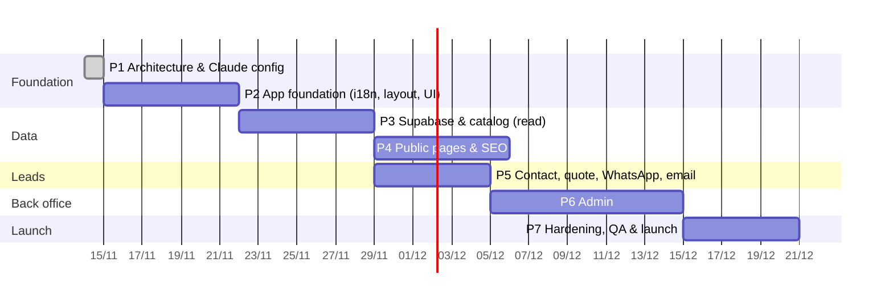

# Development Roadmap

## Phase 2 MVP milestones (current — supersedes the phase list below where they differ)
| M | Scope | Status |
|---|---|---|
| M1 | Architecture conflicts resolved (ADR-009…018), design system, i18n routing + proxy, global layout & navigation | Done (branch `feat/foundation`) |
| M2 | Supabase migrations, RLS, storage policies, typed data access, seed strategy (moved before catalog — ADR-016) | Done on `mslab-dev` (branch `feat/foundation`) |
| M3 | Homepage, About, Services pages | Done (branch `feat/foundation`) |
| M4 | Catalog, product details, search, filtering, pagination, related products | Done (branch `feat/foundation`) |
| M5 | Quotation workflow (multi-product, custom items), contact system, notifications | Done (branch `feat/foundation`; email provider not chosen → delivery disabled) |
| M6 | Admin auth, dashboard, products, categories, services, quotations, inquiries, settings | Built (branch `feat/foundation`); signed-in flows await the first admin account |
| M7 | Translation completion and full RTL audit (routing already in M1) | Done (branch `feat/foundation`); Arabic/English UI copy still needs native review; visual RTL pass pending a visible browser |
| M8 | SEO, accessibility, performance, security, Playwright suites (desktop/tablet/mobile) | Done (branch `feat/foundation`); signed-in admin E2E needs owner-provided test credentials |
| M9 | Production readiness review, Vercel preparation (no deploy without approval) | Done — see `PRODUCTION_READINESS.md` (launch blocked by content + owner actions) and `DEPLOYMENT_RUNBOOK.md` |

---

Each phase ends with a reviewed PR to `main`, a green build, and a Vercel preview. Phases 2+ assume the Phase 1 decisions are approved.

Durations are indicative; content availability from MSLAB is the main schedule risk.

## Phase 1 — Architecture & foundation ✅ (this phase)
- Repository audit, architecture, schema, routing, security docs.
- `CLAUDE.md`, 8 skills, 5 agents.
- **Acceptance:** docs reviewed by owner; open questions answered or accepted as assumptions.

## Phase 2 — Application foundation
Depends on: P1 approval, logo/colors (can start with provisional tokens).
- First commit + branch protection; CI workflow (lint, typecheck, build).
- Add `zod`, `server-only`; `src/lib/env.ts`; `.env.example`.
- i18n: `src/i18n/{config,routes,negotiate,dictionaries}`, `app/[lang]/layout.tsx` with `lang`/`dir`, `generateStaticParams`; `proxy.ts` (negotiation + rewrites + canonical redirects).
- Replace template `layout.tsx`/`page.tsx` (justified in PR); design tokens in `globals.css`; Latin + Arabic fonts.
- UI primitives (`components/ui`), Header/Footer/LanguageSwitcher/MobileNav, `not-found`, `error`, `loading`.
- `src/config/business.ts` with verified facts only.
- Playwright setup + smoke test (each locale renders, `dir=rtl` on `/ar`).
- **Acceptance:** `/fr`, `/ar`, `/en` render an empty branded shell; localized URL rewrites/redirects work; Lighthouse a11y ≥ 95.

## Phase 3 — Supabase & catalog (read side)
Depends on: P2; Supabase dev project created by owner.
- Local Supabase stack; migrations for enums, catalog tables, `is_admin()`, RLS, storage bucket `catalog`; seed with **fictional** sample data for local only.
- Generated types; `lib/supabase/public.ts`; `features/catalog/queries.ts` with `'use cache'` + tags.
- Catalog index, category, product pages; search & filters (`search_products`).
- **Acceptance:** RLS matrix for catalog passes; unpublished items invisible; pages render in 3 locales with translations and fallback.

## Phase 4 — Public pages & SEO
Depends on: P3; MSLAB content (about, services).
- Home, About, Services (+ detail), Legal, Privacy pages from verified content.
- `buildPageMetadata`, hreflang, `sitemap.ts`, `robots.ts`, JSON-LD (verified fields only), OG images.
- `slug_redirects` support.
- **Acceptance:** SEO checklist green on all templates; Lighthouse mobile perf ≥ 90, SEO = 100.

## Phase 5 — Customer interaction
Depends on: P3 (product references); email provider + domain decision; WhatsApp number.
- Migrations: inquiries, items, `submit_inquiry`; Zod schemas; contact + quote forms (progressive enhancement); anti-spam; `after()` notifications; WhatsApp buttons.
- **Acceptance:** E2E: contact & quote submit in fr/ar succeed and create rows; spam controls verified; notification email received on preview (test inbox).

## Phase 6 — Administration
Depends on: P5; admin users list.
- `@supabase/ssr`, admin root layout, login/logout, password reset, `requireAdmin()`, proxy session refresh.
- Product & category CRUD with translations, image upload/reorder/primary, publish toggles, `updateTag`.
- Inquiry list/detail/status/notes; dashboard; audit log.
- **Acceptance:** non-admin cannot access any admin page or action (tested); edits appear publicly after invalidation; image rules enforced.

## Phase 7 — Hardening, QA & launch
- Security headers/CSP, Supabase advisors clean, `npm audit` review, secret scan of build output.
- Full E2E suite (3 locales × mobile/desktop), accessibility audit, cross-browser check.
- Production Supabase migrations applied **by owner**; env vars set; domain + email DNS; Search Console.
- **Acceptance:** release checklist in `mslab-deployment` skill complete.

## Later (backlog)
Artwork file uploads for print quotes; DB-managed services; inquiry CSV export; analytics (consent-aware); book-specific attributes (ISBN, author); price display if policy allows; newsletter.

## Recommended immediate next steps
1. Owner reviews docs and answers open questions (`PROJECT_OVERVIEW.md` §6, `DATABASE_SCHEMA.md` §7, ADR-003/008).
2. Make the initial commit and push `main`.
3. Move the repo out of OneDrive / flatten nested folder.
4. Create Supabase **dev** project; choose email provider; secure domain.
5. Start Phase 2.

## Quality gates (M8)
| Command | What it checks |
|---|---|
| `npm run lint` · `npm run typecheck` · `npm run build` | static checks, production build |
| `npm run test:unit` | validation, phone rules, dictionary parity, RTL-safe classes |
| `npm run test:integration` | public DB API + RLS (dev project) |
| `BASE_URL=… npm run test:http` | forms without JavaScript |
| `npm run test:e2e` | Playwright: 3 viewports, fr/ar/en, RTL, quote list, contact, axe WCAG 2.2 AA, admin guard, headers |
| `BASE_URL=… node scripts/perf-check.mjs` | LCP/CLS/page weight on throttled mobile |

M8 measurements (throttled Pixel 7, 4× CPU): LCP 0.4–1.1 s, CLS 0, fonts 29–51 KB on fr/en pages (197 KB on Arabic pages), JS ≈ 490 KB uncompressed (framework baseline).
