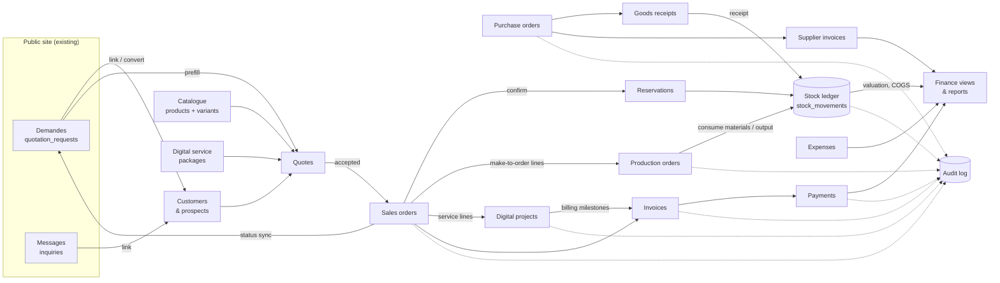

# MSLAB Internal ERP — Architecture (revised 2026-11-22)

> **Status: Proposed (ADR-027).** Nothing in this document is implemented yet. It replaces the earlier
> idea of a public "digital services pricing page": the ERP is an **internal business management
> system** inside the existing `/admin` back office. No ERP data (prices, costs, margins, staff,
> stock, customers) is ever exposed on the public site.
>
> Rules inherited from `CLAUDE.md` stay in force: RLS on every table, no secret key in request paths,
> Zod + server-side authorization in every action, no invented business data, no placeholder pages,
> migrations reviewed and applied only on explicit request.

---

## 0. Audit of the current implementation (what we build on)

Reviewed: `supabase/migrations/*` (16 files), the live `mslab-dev` project (tables, row counts,
migration history), `src/features/admin/*`, `src/app/admin/(panel)/*`, `src/components/admin/*`,
`docs/SECURITY_STRATEGY.md`, `docs/DATABASE_SCHEMA.md`, `docs/SYSTEM_ARCHITECTURE.md`.

### 0.1 What already exists and is reused

| Existing piece | Where | Role in the ERP |
|---|---|---|
| `admin_profiles` (+ `admin_role` = `owner \| editor`) | migration `…130000` | Becomes the **staff** table (extended, not replaced) |
| `private.is_admin()` / `is_owner()` — active profile **and** MFA (`aal2`) | `…130100`, `…19100000` | Kept as the identity check; ERP adds `private.can(permission)` on top |
| `requireAdmin()` / `requireOwner()` DAL | `features/admin/auth.ts` | Kept; ERP adds `requirePermission()` |
| Admin action pattern: `requireAdmin → Zod → session client (RLS) → refresh` and `AdminActionState` | `features/admin/*-actions.ts`, `action-state.ts` | Same pattern for every ERP action |
| Admin UI kit: `AdminPageHeader, Panel, Table, Td, FilterBar, Dl, Tile, StatusBadge, Notice, EmptyState`, `AdminForm`, `fields.tsx` | `components/admin/` | All ERP screens use these (no second design system) |
| Admin i18n fr/en/ar (RTL) | `features/admin/dictionary.ts` (ADR-015) | ERP strings added to the same dictionary |
| `quotation_requests` (+ `quotation_items`, `custom_request_details`, `digital_request_details`, `quotation_files`, `quotation_status_events`), kinds `catalog \| custom \| digital` | `…130000`, `…15100000`, `…21120000` | Become the **lead / request intake** of Sales & CRM. Not duplicated |
| Public order tracking `track_quotation` (reference + e-mail) | `…15100000` | Keeps working; request status is synchronised from the sales order |
| `inquiries` (contact messages) | `…130000` | Stays as the CRM message inbox |
| `products`, `product_images`, `categories` (public catalog, no prices — ADR-007) | `…130000` | Remain the **public presentation** of products; ERP adds internal sibling tables |
| `services` (6 core production lines, public) | `…130000` | Public content; the internal service catalogue links to it optionally |
| `production_options` (materials, finishes — public read) | `…15100000` | Reused as customization options; internal costs live in a sibling table |
| `studio_*`, `mockup_products`, `portfolio_items` | `…15120000`, `…18150000` | Website features, unchanged; grouped under "Site web" |
| `site_settings` (public read!) incl. `legal_facts` (RC, ICE…) | `…130000`, `…18120000` | Public facts only. ERP settings go in a **separate staff-only** singleton |
| Private bucket `custom-uploads` | `…15100000` | Customer artwork, read by staff; ERP documents get their own private bucket |

### 0.2 Findings that shape the design

1. **Authorization is all-or-nothing today.** Every policy is `private.is_admin()`. Any account with
   an active `admin_profiles` row can read every customer, quote and setting. Creating accounts for
   designers or developers *before* changing this would expose all data to them.
   → Phase 0 introduces permissions and migrates existing policies **before** any new account exists.
2. **No customer entity.** Customer identity is copied into each request (`full_name`, `email`,
   `phone`, `company_name`). → `customers` + `customer_contacts`, linked from requests (nullable FK).
3. **"Quotations" in the admin are requests, not priced quotes.** `quotation_status` already carries an
   order lifecycle (`accepted → in_production → ready → delivered`). → priced quotes and sales orders
   are new documents; the request keeps a status *derived* from its order so public tracking keeps working.
4. **Public-read tables must never receive internal columns.** `products`, `production_options`,
   `services`, `site_settings` are readable by `anon`. Postgres column grants cannot distinguish staff
   roles (all staff use the `authenticated` DB role). → every internal field (cost, price, margin,
   supplier, stock) lives in a **sibling table with staff-only RLS**.
5. **No audit log** beyond `quotation_status_events`. → generic audit trigger in Phase 0.
6. **Migration drift between the repo and `mslab-dev`:**
   - applied remotely but missing locally: `print_on_demand_attach_listed_files`, `mockup_products_hoodie_poster`;
   - present locally but not in the remote history: `20261118150000_studio_configuration.sql`
     (its tables exist remotely, so it was applied under another name or by hand).
   → must be reconciled first (Phase 0, step 1). New ERP migrations are not written on top of an unknown state.
7. **No service-role key at runtime** (SECURITY_STRATEGY §1). Creating Auth users needs the Auth
   admin API → decision D2 (Edge Function vs. dashboard invitations).
8. **Supabase Free plan** (ADR-020): no automatic daily backups / PITR. Acceptable for a website,
   risky for invoices and payments → decision D3.
9. Live data volume is small (7 requests, 15 messages, 18 products, 1 admin), so migrations can
   backfill safely; no automatic customer creation from existing requests (some may be tests/spam) —
   staff convert them explicitly.

---

## 1. Navigation architecture

**Recommendation: one unified back office.** The ERP *is* the admin: the website content becomes one
section ("Site web") instead of building a second workspace beside it (that would duplicate the shell,
auth, i18n and the requests inbox). URLs stay under `/admin/*`; the sidebar is grouped and filtered
by the signed-in user's permissions (UI convenience only — every page and action re-checks).

| Group | Entry (route) | Contents | Status |
|---|---|---|---|
| **Vue d'ensemble** | `/admin` | Company dashboard (KPIs, date filter), pending tasks, alerts, recent activity, operational performance | extends existing dashboard |
| | `/admin/notifications` | Personal notification inbox | new |
| **Entreprise** | `/admin/company/staff` | Employees & associates, profile, department, assigned responsibilities | new (on `admin_profiles`) |
| | `/admin/company/departments` | Departments | new |
| | `/admin/company/roles` | Roles & permission matrix (Administrator only) | new |
| | `/admin/company/activity` | Internal activity feed (audit, filtered) | new |
| **Ventes & CRM** | `/admin/quotations` → label "Demandes" | Incoming requests (catalog / custom / digital) — existing inbox, + "link customer" and "prepare quote" | existing |
| | `/admin/inquiries` → "Messages" | Contact messages | existing |
| | `/admin/customers` | Customers & prospects (`?stage=prospect`), contacts, follow-ups, history | new |
| | `/admin/sales/quotes` | Priced quotes (devis), versions, PDF | new |
| | `/admin/sales/orders` | Sales orders (bons de commande), reservations, delivery notes | new |
| | `/admin/sales/invoices` | Customer invoices (factures), credit notes (avoirs) | new |
| | `/admin/sales/payments` | Customer payments & allocations | new |
| | `/admin/sales/follow-ups` | Follow-up tasks (calls, relaunches) | new |
| **Produits & services** | `/admin/products` | Public catalogue (existing) + new internal tabs: variants, prices, BOM | existing + tabs |
| | `/admin/categories` | Categories | existing |
| | `/admin/offer/services` | Digital service catalogue: categories, packages, features, deliverables, extras, maintenance | new |
| | `/admin/offer/options` | Customization options & their costs (materials, finishes, techniques) | new (reuses `production_options`) |
| | `/admin/offer/pricing` | Price lists, labour rates, cost estimation | new |
| **Stock** | `/admin/inventory` | Available stock (on hand / reserved / available), raw materials vs. products filter, alerts, valuation | new |
| | `/admin/inventory/movements` | Stock ledger (every movement with its source) | new |
| | `/admin/inventory/adjustments` | Counts & adjustments (with approval) | new |
| **Achats** | `/admin/procurement/suppliers` | Suppliers & contacts | new |
| | `/admin/procurement/requests` | Purchase requests (demandes d'achat) & approval | new |
| | `/admin/procurement/orders` | Purchase orders, expected deliveries | new |
| | `/admin/procurement/receipts` | Goods receipts (bons de réception) | new |
| | `/admin/procurement/invoices` | Supplier invoices & payments, purchase history | new |
| **Production** | `/admin/production` | Production orders (ordres de fabrication), board by stage | new |
| | `/admin/production/[id]` | Stages & assignments, artwork proofs, material consumption, quality control, completion | new |
| **Projets digitaux** | `/admin/projects` | Website / application / branding projects | new |
| | `/admin/projects/[id]` | Members, milestones, tasks, deliverables, deadlines, customer feedback, time entries | new |
| **Finance** | `/admin/finance` | Revenue, expenses, payments in/out, outstanding balances, cash flow, profitability | new |
| | `/admin/finance/expenses` | Expenses (with receipts) | new |
| **Rapports** | `/admin/reports/{sales,inventory,customers,production,staff,finance}` | Report pages + CSV export | new |
| **Site web** | `/admin/services`, `/admin/print-on-demand`, `/admin/settings` (public info) | Existing website content | existing (regrouped) |
| **Paramètres** | `/admin/settings/company` | Company info (internal), document numbering, taxes, currency, notifications | new |
| | `/admin/company/roles` | Permissions (same screen as above) | new |

Routes are added with Next.js 16 conventions (`PageProps`, async `params`, session reads under
`<Suspense>`) — read `node_modules/next/dist/docs/` before each new pattern.

---

## 2. Module relationships

### 2.1 Business events and their effects (all inside one database transaction)

| Event (RPC) | Preconditions | Effects | Idempotency / guard |
|---|---|---|---|
| `quote_accept(quote_id)` | quote `sent`, not expired | creates sales order from the accepted version (lines copied as snapshots); quote → `accepted`; request status → `accepted` | unique `sales_orders.quote_id` |
| `sales_order_confirm(order_id)` | order `draft` | for stocked lines: reservation per line (`available ≥ qty`, else error or partial per setting); make-to-order lines: production orders created; service lines: project created; order → `confirmed` | row lock on order + `stock_levels`; state check |
| `sales_order_cancel(order_id, reason)` | not `delivered`/`invoiced` | active reservations → `released` (available stock restored); open production orders → `cancelled` (consumed material stays consumed; returns via a movement); request → `closed` | state check |
| `delivery_post(delivery_id)` | lines ≤ remaining qty | reservation → `consumed`, `issue` movement per line (source = delivery note); order → `partially_delivered`/`delivered`; request → `delivered` | unique movement `(source_type, source_line_id)` |
| `production_consume(mo_id, lines)` | MO `in_progress` | `production_consume` movements; actual material cost recorded on the MO | `client_key` unique |
| `production_complete(mo_id, qty_good, qty_rejected)` | QC recorded | optional `production_output` movement (stocked goods); MO → `completed`; order/request → `ready` when all its MOs are done | state check |
| `goods_receipt_post(receipt_id)` | PO `sent`/`partially_received`, qty ≤ outstanding | `receipt` movements at PO unit cost; weighted average cost updated; PO status recalculated | unique movement per receipt line |
| `stock_adjust(adjustment_id)` | approved (above threshold) | `adjustment` movement(s) with reason | state check |
| `invoice_issue(invoice_id)` | draft, totals > 0 | gapless number assigned from `document_sequences`; invoice locked (no more edits, corrections by credit note) | state check + number unique |
| `payment_record(…, client_key)` | amount > 0 | payment row + allocations; allocations ≤ invoice balance; invoice → `partially_paid`/`paid` | unique `client_key`; trigger checks Σ allocations ≤ total |
| `supplier_invoice_post`, `supplier_payment_record` | idem for payables | idem | idem |

Every movement and financial row stores `source_type` + `source_id` (+ `source_line_id`) and
`created_by`; managers open any record and see its full timeline (status events + audit log).

---

## 3. Employee roles and permission matrix

### 3.1 Model

- **Accounts:** one Supabase Auth user per person; MFA mandatory (already enforced via `aal2`).
- **Staff record:** `admin_profiles` extended (`kind` employee/associate, `job_title`,
  `department_id`, `phone`). The `role` column is kept for compatibility during the transition.
- **Roles & permissions:** `roles`, `permissions` (key catalogue), `role_permissions (role, permission, scope)`
  with `scope ∈ {all, assigned}`, `staff_roles (staff_id, role_id)` (several roles per person allowed).
- **Helpers (schema `private`, MFA-aware like `is_admin`):**
  `private.can(p text)` — any scope; `private.can_all(p text)` — scope `all`;
  `private.is_assigned(entity, id)` — membership / assignee check.
  Typical policy: `using (private.can_all('production.read') or (private.can('production.read') and private.is_assigned('production_order', id)))`.
- **Server side:** `requirePermission('sales.quote.write')` in `features/erp/auth.ts`, built on
  `requireAdmin()`; permissions loaded once per request (`cache`) via an RPC `my_permissions()`.
- **Overview for everyone authorized:** `overview.read` grants a **read-only company dashboard**
  through a SECURITY DEFINER RPC that returns aggregates only; monetary figures are included only
  when the caller also has `finance.read`.
- **Migration of today's accounts:** `owner` → *Administrator*; `editor` → *Website editor* (exactly
  today's rights on site content). The existing owner keeps full access.

### 3.2 Matrix

Legend: **F** full (create, edit, approve, delete where allowed) · **E** create/edit · **A** only
records assigned to them (read + work on them) · **R** read · **S** summary on the dashboard only · — none.

| Module / data | Admin | Manager | Sales | Production | Stock & purchasing | Designer | Developer | Accounting* | Website editor |
|---|---|---|---|---|---|---|---|---|---|
| Company dashboard | F | F | S | S | S | S | S | F | S |
| Staff directory (name, role, dept.) | F | R | R | R | R | R | R | R | R |
| Roles & permissions | F | — | — | — | — | — | — | — | — |
| Audit log / internal activity | R | R | — | — | — | — | — | — | — |
| Requests inbox (existing) | F | F | E | R (custom) | — | A (custom) | A (digital) | — | — |
| Customers & prospects, follow-ups | F | F | E | R (on own orders) | — | A | A | R | — |
| Quotes | F | F (approves discounts above threshold) | E | — | — | A (read) | A (read) | R | — |
| Sales orders & deliveries | F | F | E | R | R | A | A | R | — |
| Customer invoices & payments | F | R | R (own customers) | — | — | — | — | F | — |
| Public catalogue content | F | E | R | R | R | R | — | — | E |
| Selling prices / price lists | F | F | R | — | — | — | — | R | — |
| **Costs & margins** | F | F | — | — | R (purchase costs) | — | — | R | — |
| Digital service catalogue (no costs) | F | F | R | — | — | R | R | R | — |
| Stock levels & movements | F | R | R (availability) | R | F | — | — | R (valuation) | — |
| Stock adjustments | F | approves | — | — | E | — | — | R | — |
| Suppliers, purchase requests & orders | F | approves | — | E (purchase requests) | F | — | — | R | — |
| Supplier invoices & payments | F | R | — | — | R | — | — | F | — |
| Production orders, stages, QC | F | F | R (status) | A → E (all read) | R | A (artwork stage) | — | R (cost) | — |
| Artwork proofs & approvals | F | F | R | R | — | E | — | — | — |
| Digital projects, tasks, deliverables | F | F | R (status) | — | — | A | A | R (billing) | — |
| Time entries | F | R | — | E (own) | — | E (own) | E (own) | R | — |
| Expenses | F | F | — | — | — | — | — | F | — |
| Finance (revenue, cash flow, profitability) | F | F | — | — | — | — | — | F | — |
| Reports | all | all | sales (own team) | production | inventory, purchases | — | — | finance | — |
| Settings (company, numbering, tax, currency) | F | R | — | — | — | — | — | R (tax) | — |
| Website content (services, studio, portfolio, public settings) | F | E | — | — | — | — | — | — | E |

\* *Accounting* is not in the brief's role list; it is suggested because invoices, payments and
expenses need an owner other than the administrator. Drop it if MSLAB has no such person.

Roles are rows, not code: the Administrator can create a role (e.g. "Sales + Design") from the matrix
screen. The permission **keys** are fixed in code and seeded by migration.

---

## 4. Database architecture

Conventions (same as today): `uuid` PKs, `created_at/updated_at` + `set_updated_at` trigger,
`created_by` → `admin_profiles`, CHECK constraints for lengths, enums for lifecycles, money as
`numeric(14,2)`, quantities `numeric(14,3)` + `unit`, `currency char(3) default 'MAD'` on documents.
RLS enabled in the same migration as each table; `anon` has no grants on ERP tables.

### 4.1 Platform (Phase 0)

| Table / object | Key columns | Notes |
|---|---|---|
| `departments` | name, manager_id | |
| `admin_profiles` (extended) | + kind, job_title, department_id, phone, last_seen_at | still the staff table |
| `roles`, `permissions`, `role_permissions`, `staff_roles` | see §3.1 | seeded; edits only by `roles.manage` |
| `erp_settings` (singleton, **staff-only**) | legal identity for documents (RC, ICE, IF, patente, TVA regime — read from `site_settings.legal_facts` where already entered), default currency, default payment terms, quote validity days, low-stock rule, discount approval threshold, adjustment approval threshold | never public |
| `tax_rates` | code, label, rate, is_default, is_active | values entered by MSLAB / its accountant — none invented |
| `document_sequences` | doc_type, year, prefix, next_value, padding | `next_document_number()` locks the row → gapless numbers (`DEV`, `BC`, `BL`, `FAC`, `AV`, `DA`, `BCF`, `BR`, `OF`, `PRJ` — prefixes editable) |
| `audit.log` (schema `audit`, not exposed) | table_name, row_id, action, actor_id, changed jsonb (diff), at | generic trigger on ERP tables + `quotation_requests`, `admin_profiles`, `site_settings`; insert-only; read through `audit_timeline(entity, id)` / `recent_activity()` RPCs that filter by the caller's permissions |
| `notifications` | recipient_id, type, entity_type, entity_id, payload, read_at | created by RPCs/triggers; e-mail later via the existing provider interface (ADR-008) |
| `attachments` | entity_type, entity_id, storage_path, name, mime, size | private bucket `erp-documents` (receipts, supplier invoices, proofs, deliverables) |

### 4.2 Sales & CRM

| Table | Key columns | Notes |
|---|---|---|
| `customers` | type (company/institution/individual), stage (prospect/active/inactive), name, ICE, IF, RC, billing/shipping address, payment_terms, owner_id (sales), source | unique partial index on ICE; duplicate detection on e-mail/phone |
| `customer_contacts` | customer_id, name, role, email, phone, is_primary | |
| `quotation_requests` (existing) | **+ customer_id** (nullable FK) | no other change |
| `inquiries` (existing) | **+ customer_id** (nullable FK) | |
| `customer_follow_ups` | customer_id, request/quote/order ref, due_at, type, assignee_id, status, outcome | feeds "pending tasks" |
| `sales_quotes` | number, customer_id, request_id, status (draft/sent/accepted/rejected/expired/cancelled), current_version, valid_until, owner_id | |
| `sales_quote_versions` | quote_id, version, lines snapshot totals, sent_at | a sent version is immutable; changes create a new version |
| `sales_quote_lines` | version_id, line_type (product_variant/service_package/service_extra/custom/text), ref ids, description, qty, unit, unit_price, discount_pct, tax_rate_id, **estimated_unit_cost** (sibling `sales_quote_line_costs`, cost-restricted) | |
| `sales_orders` | number, customer_id, quote_id (unique), request_id, status (draft/confirmed/in_progress/ready/partially_delivered/delivered/invoiced/closed/cancelled), promised_date | trigger mirrors status into `quotation_requests.status` for public tracking |
| `sales_order_lines` | order_id, snapshot of quote line, fulfilment (stock/make_to_order/service), qty_delivered, qty_invoiced | |
| `deliveries` + `delivery_lines` | number (BL), order_id, delivered_at, received_by | posts `issue` movements |
| `invoices` + `invoice_lines` | number (FAC), customer_id, order_id / milestone_id, kind (invoice/credit_note/deposit), status (draft/issued/partially_paid/paid/void), issue_date, due_date, totals HT/TVA/TTC, customer legal snapshot | locked once issued |
| `payments` + `payment_allocations` | customer_id, date, method (transfer/cheque/cash/card/other), amount, reference, **client_key unique**; allocation (payment_id, invoice_id, amount) | Σ allocations ≤ payment and ≤ invoice balance (constraint trigger) |

### 4.3 Products, services & pricing

| Table | Key columns | Notes |
|---|---|---|
| `products` (existing, public) | unchanged | marketing content only |
| `product_variants` (staff-only) | product_id (nullable — internal items may have no public page), sku unique, attributes jsonb (size, colour, paper…), unit, is_stocked, is_active | the sellable / stockable unit |
| `price_lists`, `price_list_items` | variant_id, min_qty (quantity breaks — MSLAB sells in bulk), unit_price, valid_from/to | selling prices |
| `item_costs` (cost-restricted) | variant/item id, standard_cost, last_purchase_cost, avg_cost (maintained by stock RPCs) | |
| `production_option_costs` (cost-restricted) | production_option_id (existing table), price_modifier, cost_modifier, unit basis (per unit/per order/per m²) | public table untouched |
| `bom_lines` | variant_id, component_item_id, qty_per_unit, waste_pct | basis for material consumption and cost estimation |
| `labour_rates` (cost-restricted) | activity (prepress, printing, finishing, development, design), hourly_cost, hourly_price | |
| `service_categories` | name fr/ar/en, kind (website, webapp, branding, graphic_design, seo, maintenance — rows, not enum), public_service_id / digital project-type key (optional link) | the six examples are seeded **only as category names if the owner confirms**; no packages or prices seeded |
| `service_packages` | category_id, name, description, est_hours, est_delivery_days, selling_price, maintenance_option, is_active, sort | |
| `service_package_costs` (cost-restricted) | package_id, internal_cost, margin (generated) | |
| `service_package_features`, `service_package_deliverables` | package_id, label, sort | |
| `service_extras` | category_id / package_id, name, unit, price (+ cost in sibling table), is_recurring | optional billable items, maintenance |
| `inventory_items` | kind (raw_material/consumable/finished_good/merchandise), variant_id (nullable), name, unit, reorder_point, reorder_qty, preferred_supplier_id, is_active | raw materials (blank garments, paper, ink…) are items without a public product |

Quote preparation: choose a package → features, deliverables, hours and price are copied into the
quote line as a snapshot; extras and free lines can be added; the cost estimate (BOM × avg cost +
labour hours × rate + option modifiers) is stored per line for margin display to permitted roles.

### 4.4 Inventory

| Table | Key columns | Notes |
|---|---|---|
| `stock_locations` | name, kind (warehouse/workshop/transit), is_default | one location to start |
| `stock_levels` | item_id, location_id, qty_on_hand, qty_reserved, qty_available (generated), avg_cost | **only written by RPCs**; `CHECK (qty_on_hand >= 0 and qty_reserved >= 0 and qty_reserved <= qty_on_hand)` makes inconsistent stock impossible |
| `stock_movements` (ledger) | item_id, location_id, qty (signed), type (receipt/issue/adjustment/transfer_in/transfer_out/production_consume/production_output/return), unit_cost, source_type, source_id, source_line_id, client_key, created_by, created_at | **append-only** (no update/delete grants); unique `(source_type, source_line_id, type)` prevents double posting; corrections = reversing movement |
| `stock_reservations` | item_id, location_id, order_line_id, qty, status (active/released/consumed) | |
| `stock_adjustments` + lines | reason, status (draft/pending_approval/approved/posted), counted_qty | |
| Views | `v_stock_alerts` (available ≤ reorder_point), `v_stock_valuation` (on_hand × avg_cost) | |

Valuation method proposed: **weighted average cost** (simple, standard for SMEs) → decision D5.

### 4.5 Procurement

`suppliers`, `supplier_contacts`, `purchase_requests` + lines (requested_by, status, approval),
`purchase_orders` + lines (number BCF, supplier, expected_date, status draft/sent/partially_received/received/closed/cancelled),
`goods_receipts` + lines (number BR, posts `receipt` movements, updates avg cost),
`supplier_invoices` + lines (supplier ref unique per supplier, linked PO, status, due_date),
`supplier_payments` (client_key unique). Purchase history = view over PO + receipts + invoices.

### 4.6 Production

| Table | Key columns | Notes |
|---|---|---|
| `production_stage_templates` | name, sort, applies_to (category/product kind) | e.g. prepress, printing, finishing, packing — entered by MSLAB |
| `production_orders` | number OF, sales_order_line_id (nullable for stock builds), variant/custom spec snapshot (from `custom_request_details` incl. Studio `design`), qty, due_date, status (planned/released/in_progress/quality_check/completed/cancelled), responsible_id | |
| `production_order_stages` | mo_id, stage, assignee_id, status, started_at, finished_at | work assignments |
| `production_order_materials` | mo_id, item_id, planned_qty (from BOM), consumed_qty | consumption posts movements |
| `quality_checks` | mo_id, stage, result (pass/fail/rework), qty_checked, qty_rejected, notes, checked_by | |
| `artwork_proofs` | order/request id, version, file (attachment), status (pending/approved/changes_requested), customer decision recorded by staff, decided_at | designers' workflow; customer artwork itself stays in `custom-uploads` |

### 4.7 Digital projects

`projects` (number PRJ, customer, sales_order_id, service_package_id, type, status, start/due dates,
manager_id), `project_members`, `project_milestones` (due date, amount, invoice_id unique — one invoice
per billing milestone), `project_tasks` (assignee, status, priority, due, est/actual hours),
`project_deliverables` (status, url/attachment, approved_at), `project_feedback` (logged by staff,
source, content), `time_entries` (staff, project/MO, date, hours — cost from `labour_rates`).

### 4.8 Finance

`expense_categories`, `expenses` (date, category, supplier optional, amount HT/TVA, payment method,
attachment, allocation to project / production order / overhead, status submitted/approved/paid).
Views / RPCs (no duplicated totals stored): `v_receivables` (invoice balance, ageing), `v_payables`,
`v_cash_flow` (payments in − supplier payments − paid expenses by period), `v_order_profitability`
(revenue − material cost from movements − labour from time entries − direct expenses),
`v_project_profitability`, `v_revenue_by_period`.

### 4.9 Access-control layering (summary)

1. `proxy.ts` refreshes the session (not a security boundary — unchanged).
2. `requireAdmin()` + `requirePermission()` on every page and action.
3. RLS on every table with `private.can*()`; cost-restricted sibling tables require `costs.read`.
4. Ledger and document-state changes only through SECURITY DEFINER RPCs (`set search_path = ''`,
   explicit permission check as their first statement, row locks, state-machine checks). Direct
   INSERT/UPDATE on `stock_movements`, `stock_levels`, `payments`, issued `invoices` is not granted.
5. Audit trigger on every ERP table.

---

## 5. Integration plan with the existing admin

| Existing feature | Change | Risk control |
|---|---|---|
| Admin shell & nav (`(panel)/layout.tsx`, `admin-nav.tsx`) | grouped nav from §1, filtered by `my_permissions()`; badges keep working | snapshot/e2e test of current nav for the owner |
| Dashboard `/admin` | keeps "to handle" + quick actions; ERP KPI tiles added per phase, each wired to a real query | no tile ships without its data source |
| Requests `/admin/quotations` | label "Demandes"; detail page gains "Customer" panel (link/create) and "Prepare quote" (prefilled from items, custom & digital details) | status select stays for requests without an order; becomes read-only (derived) once an order exists |
| Public tracking `track_quotation` | unchanged; fed by the order→request status trigger | integration test: order status change ⇒ tracking result |
| Messages `/admin/inquiries` | + "Link to customer" | — |
| Products `/admin/products/[id]` | + tabs "Variants & prices", "Bill of materials" (only shown with permission) | public `products` table/policies untouched |
| `production_options` | costs in `production_option_costs` | public read policy untouched |
| Services, Print-on-demand, Studio, Portfolio | moved under "Site web" in the nav, no code change | — |
| `/admin/settings` | stays = public site information; ERP settings at `/admin/settings/company` | `site_settings` never receives internal fields |
| `admin_profiles.role`, `is_owner()` | mapped to roles; `is_owner()` callers migrated to `can('roles.manage')` etc. | policies migrated in one reviewed migration with RLS tests per role |
| Admin dictionary (fr/en/ar) | ERP keys added; `i18n-quality` unit test extended | RTL checks at 360 px |
| `tests/integration` | new RLS-per-role and RPC invariant tests | must pass before each phase ships |

Nothing existing is renamed or dropped. Table renames are avoided on purpose (`quotation_requests`
keeps its name; only UI labels change).

---

## 6. Implementation phases

Each phase = reviewed migration(s) + RLS/RPC tests + screens + dictionary + docs, applied to
`mslab-dev` first, production only on explicit request. A phase is "done" only when its screens
read and write real rows and its dashboard tiles show real figures.

| Phase | Scope | Exit criteria |
|---|---|---|
| **0. Foundations** | 1) reconcile migration drift (§0.2-6) and regenerate `database.types.ts`; 2) audit log; 3) roles/permissions + `private.can*`, migrate **all existing policies**, map owner/editor; 4) staff extension, departments, staff screens, account onboarding (D2); 5) `erp_settings`, `tax_rates`, `document_sequences`, attachments bucket, notifications; 6) permission-filtered nav | current admin behaves identically for the owner; RLS tests prove a "Designer" test account cannot read customers/quotes; audit rows written |
| **1. Customers & CRM** | customers, contacts, prospects, follow-ups; link/convert from requests & messages; duplicate detection | every request can be linked; follow-ups appear in pending tasks |
| **2. Offer & pricing** | variants, price lists (quantity breaks), inventory items, costs, BOM, option costs, labour rates, digital service catalogue (categories, packages, features, deliverables, extras, maintenance) | packages selectable; costs hidden from Sales role (RLS test) |
| **3. Quotes & sales orders** | quotes with versions + PDF, discount approval, accept → order, order lifecycle, request status sync, deliveries (without stock until Phase 5) | end-to-end: request → quote → order → tracking shows status |
| **4. Invoicing, payments, expenses** | invoices & credit notes (gapless numbers, locking), payments & allocations, receivables ageing, expenses | duplicate payment with same `client_key` rejected; over-allocation rejected |
| **5. Inventory & procurement** | stock ledger, levels, reservations on confirm, release on cancel, issue on delivery, adjustments with approval, alerts, valuation; suppliers, purchase requests/orders, receipts, supplier invoices/payments | concurrency test (two confirmations for the last units → one fails); negative stock impossible; every movement traceable |
| **6. Production** | production orders from order lines, stages & assignments, artwork proofs, material consumption from BOM, QC, completion → order `ready` | MO consumption reduces stock; completion updates tracking |
| **7. Digital projects** | projects from service lines, members, milestones (→ invoices), tasks, deliverables, feedback, time entries | developer sees only own projects (RLS test); milestone invoiced once |
| **8. Overview, reports, alerts** | consolidated dashboard with date filters and role-aware sections, reports (sales, inventory, customers, production, staff activity, finance) with CSV export, notification rules | every KPI in §7 traced to a query; no figure shown to a role without the permission |

Phases 1–2 can be built in parallel after Phase 0; 3 needs 1–2; 4–7 need 3; 8 grows with each phase.

---

## 7. Dashboard KPIs (definitions)

All figures come from the views/RPCs above for the selected period (default: current month; filters:
today, 7 days, month, quarter, year, custom). Empty data shows `0` or "—", never sample values.

| KPI | Definition | Visible with |
|---|---|---|
| Total sales | Σ issued invoices HT − credit notes, period | `finance.read` |
| Monthly revenue | same, grouped by month (12 months) | `finance.read` |
| Orders awaiting processing | orders `confirmed` without started production/delivery | `sales.order.read` |
| Pending quotations | quotes `draft`/`sent` not expired + requests `new`/`in_review` | `sales.quote.read` |
| Available inventory | items in stock, Σ available qty by kind; value if `costs.read` | `inventory.read` |
| Low-stock alerts | `v_stock_alerts` count + list | `inventory.read` |
| POs awaiting reception | POs `sent`/`partially_received`, late ones flagged | `procurement.read` |
| Production in progress | MOs `released`/`in_progress`/`quality_check`, overdue flagged | `production.read` (assigned scope → own) |
| Active digital projects | projects `active`, overdue milestones flagged | `projects.read` (assigned scope → own) |
| Outstanding customer payments | Σ receivables balance, > 30/60/90 days | `finance.read` |
| Expenses | Σ approved expenses, period | `finance.read` |
| Estimated profitability | revenue − COGS (movements) − labour − expenses, period | `finance.read` + `costs.read` |

---

## 8. Decisions needed from the owner

| # | Decision | Recommendation |
|---|---|---|
| D1 | Unified admin (website = one section) vs. separate `/admin/erp` workspace | Unified (no duplicate shell/auth/inbox) |
| D2 | How staff accounts are created | Supabase Edge Function `invite-staff` (service-role key stays inside Supabase, caller must have `staff.manage` + aal2); fallback: invite from the Supabase dashboard, then attach the profile in the ERP |
| D3 | Supabase plan for financial data | Move to Pro before Phase 4 (daily backups); until then keep the manual backup routine (ADR-020) |
| D4 | Invoicing rules (number format, TVA rates, mandatory mentions, deposit invoices) | Confirm with MSLAB's accountant; values go in `erp_settings`/`tax_rates`, none hard-coded |
| D5 | Stock valuation method | Weighted average cost |
| D6 | Does MSLAB keep finished-goods stock, or only raw materials (production to order)? | Support both; default make-to-order |
| D7 | Is an "Accounting" role needed? | Yes if someone other than the owner handles invoices |
| D8 | Confirm the six digital service categories as initial rows | Seed names only after confirmation; packages/prices entered by MSLAB |

---

## 9. Out of scope for this ERP version

Payroll and HR files (salaries, contracts), multi-currency accounting, general ledger / chart of
accounts export, customer portal, online payment, e-invoicing integrations, mobile app. The schema
keeps `currency` on documents and `source_*` references so these can be added later.
