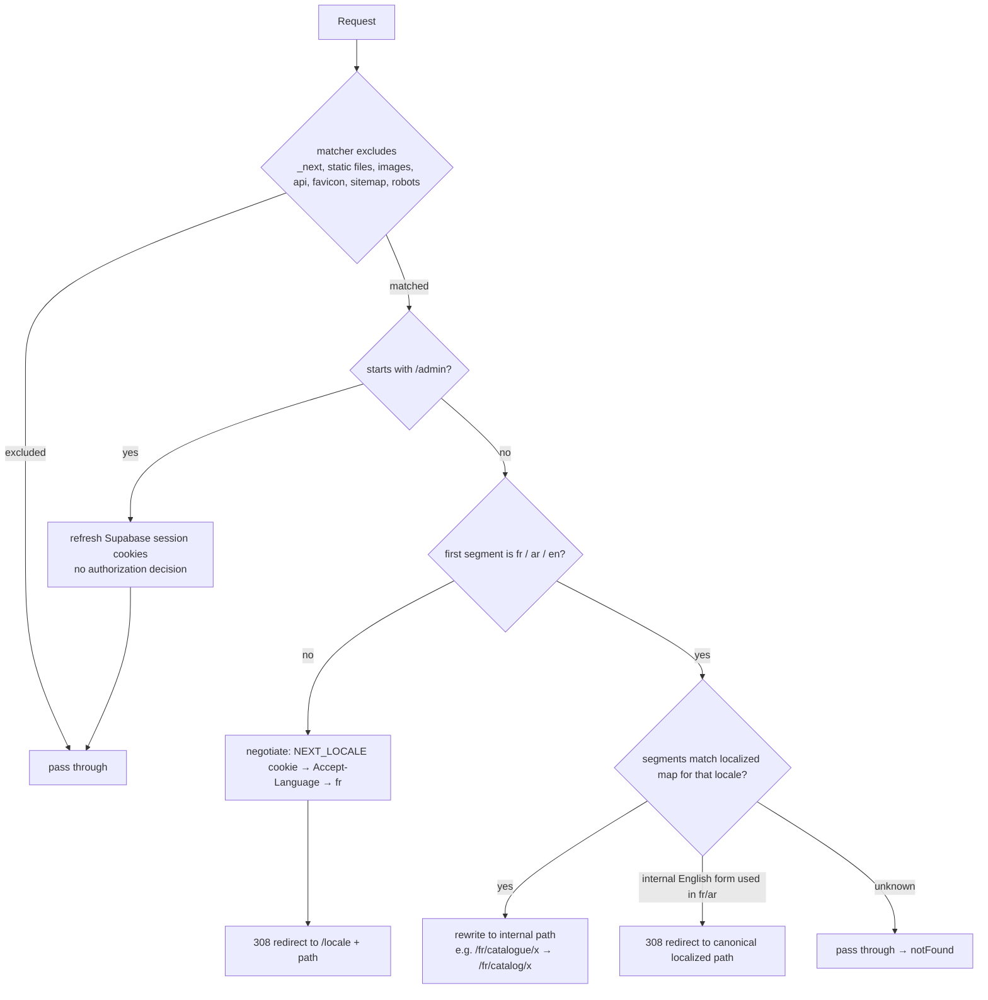

# Routing Strategy

## 1. Principles
- Every public URL carries a locale prefix: `/fr`, `/ar`, `/en`. French is the default.
- Public path segments are **localized**; internal folders use stable English names.
- One canonical URL per page per locale; everything else 308-redirects to it.
- The admin area is a separate, non-localized, non-indexed root.

## 2. File-system structure (target)
```
src/app/
  [lang]/                       # root layout #1 — <html lang dir>, generateStaticParams(fr, ar, en)
    layout.tsx
    not-found.tsx
    (site)/
      layout.tsx                # Header, Footer, WhatsApp button
      error.tsx  loading.tsx
      page.tsx                  # home
      about/page.tsx
      services/page.tsx
      services/[service]/page.tsx
      catalog/page.tsx          # catalog index + search/filter (?q=&category=&availability=&page=)
      catalog/[category]/page.tsx
      products/[product]/page.tsx
      contact/page.tsx
      quote/page.tsx            # ?product=<uuid> prefill
      quote/thank-you/page.tsx  # noindex (or inline success state)
      legal/page.tsx            # legal notice
      privacy/page.tsx          # privacy policy (Loi 09-08)
  admin/                        # root layout #2 — French UI, noindex
    layout.tsx
    login/page.tsx
    auth/confirm/route.ts       # password reset / email confirm token exchange
    (protected)/
      layout.tsx                # <Suspense> + requireAdmin()
      page.tsx                  # dashboard
      products/page.tsx  products/new/page.tsx  products/[id]/page.tsx
      categories/page.tsx  categories/[id]/page.tsx
      inquiries/page.tsx  inquiries/[id]/page.tsx
  sitemap.ts
  robots.ts
  global-error.tsx
src/proxy.ts
```
Two root layouts (`[lang]` and `admin`) are intentional: the admin has different `<html>` attributes, fonts and no public chrome. Navigation between them is a full page load, which is acceptable.

## 3. Localized URL map
| Route key | Internal | `fr` | `en` | `ar` (proposed) |
|---|---|---|---|---|
| home | `/` | `/fr` | `/en` | `/ar` |
| about | `/about` | `/fr/a-propos` | `/en/about` | `/ar/a-propos` |
| services | `/services` | `/fr/services` | `/en/services` | `/ar/services` |
| service | `/services/[service]` | `/fr/services/impression-numerique`¹ | `/en/services/digital-printing`¹ | `/ar/services/…` |
| catalog | `/catalog` | `/fr/catalogue` | `/en/catalog` | `/ar/catalogue` |
| category | `/catalog/[category]` | `/fr/catalogue/fournitures-de-bureau`¹ | `/en/catalog/office-supplies`¹ | `/ar/catalogue/<slug-ar>` |
| product | `/products/[product]` | `/fr/produits/<slug-fr>` | `/en/products/<slug-en>` | `/ar/produits/<slug-ar>` |
| contact | `/contact` | `/fr/contact` | `/en/contact` | `/ar/contact` |
| quote | `/quote` | `/fr/devis` | `/en/quote` | `/ar/devis` |
| legal | `/legal` | `/fr/mentions-legales` | `/en/legal-notice` | `/ar/mentions-legales` |
| privacy | `/privacy` | `/fr/confidentialite` | `/en/privacy` | `/ar/confidentialite` |

¹ Example slugs only — real service/category names come from MSLAB.

**Open decision (Arabic segments):** mirror French Latin segments (proposed — readable, no percent-encoding, simpler sharing) vs Arabic-script segments (slightly better local relevance, but `%D8%…` URLs when copied). Product/category slugs for `ar` are stored per translation either way.

Products live under `/produits/<slug>` (not nested under the category) so recategorizing a product never changes its URL.

## 4. `proxy.ts` behavior

- Rewrites keep the visitor-facing URL; the route tree only knows internal names.
- Redirect of `/` uses **307** (depends on visitor language), localized canonicalization uses **308**.
- Server Functions POST to the page URL; authorization is enforced inside actions, never by proxy.

## 5. Link generation
- `localizedPath(locale, routeKey, params?)` from `src/i18n/routes.ts` is the only way to build public hrefs (used by `<Link>`, metadata canonical/alternates, sitemap, emails).
- Product/category links take the **slug for that locale** from translation data.
- Language switcher: needs the route key and, for entity pages, all available translated slugs (fetched with the entity).

## 6. Search & filter URLs
`/fr/catalogue?q=ramette&category=<uuid>&availability=in_stock&page=2`
- Validated with Zod; invalid values ignored.
- Pages with `q` are `noindex, follow`; category pages are canonical without query params; pagination pages canonical to themselves.

## 7. SEO per route
| Route | Index | JSON-LD |
|---|---|---|
| home | ✅ | Organization (verified fields) |
| about, services, service | ✅ | Organization / Service (later) |
| catalog index, category | ✅ (if non-empty) | BreadcrumbList |
| product | ✅ | Product + BreadcrumbList |
| contact | ✅ | LocalBusiness (verified fields) |
| quote | ✅ | — |
| thank-you, search with `q` | ❌ | — |
| `/admin/**` | ❌ (+ disallow in robots) | — |

Every indexable page: canonical + `alternates.languages` (fr, ar, en, x-default→fr).

## 8. Redirects & errors
- Slug change on a published entity → entry in `slug_redirects` (Phase 4) consulted by the entity page before `notFound()` → `permanentRedirect()`.
- Unknown locale → 404 (not redirect) to avoid soft-404 chains.
- Localized `not-found.tsx` with links to catalog and contact.
