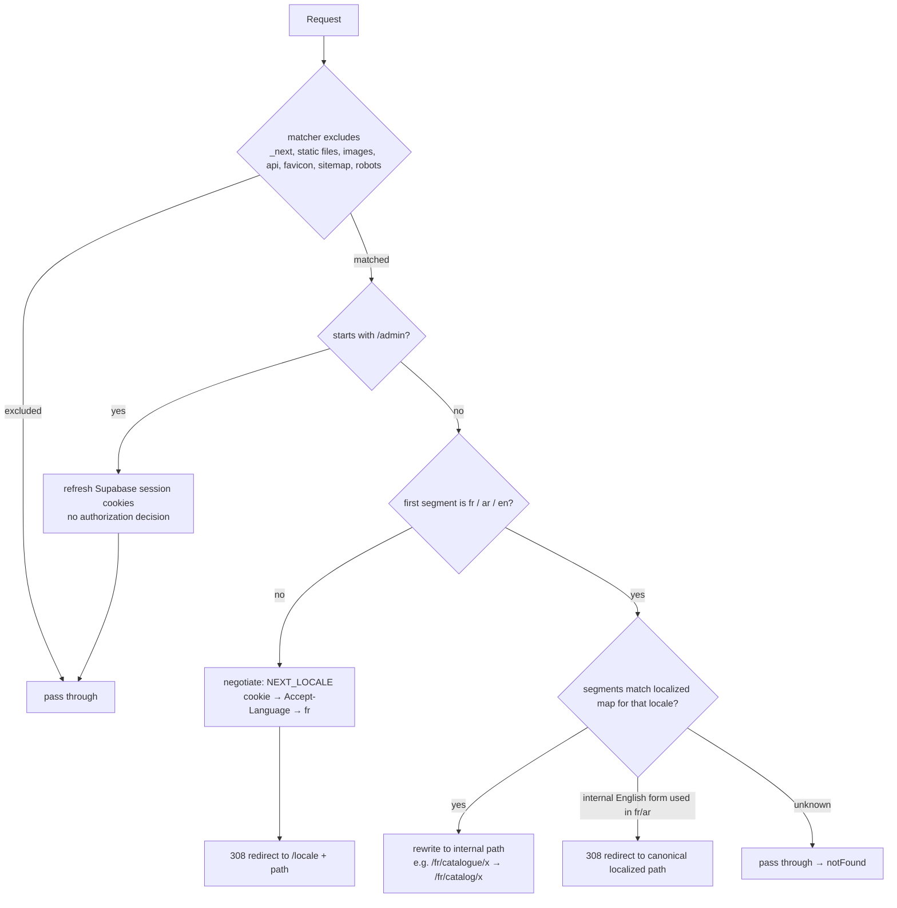

# Routing Strategy

## 1. Principles
- Every public URL carries a locale prefix: `/fr`, `/ar`, `/en`. French is the default.
- Public path segments are **localized**; internal folders use stable English names.
- One canonical URL per page per locale; everything else 308-redirects to it.
- The admin area is a separate, non-localized, non-indexed root.

## 2. File-system structure (target)
```
src/app/
  [lang]/                       # root layout #1 — <html lang dir>, generateStaticParams(fr, ar, en)
    layout.tsx
    not-found.tsx
    (site)/
      layout.tsx                # Header, Footer, WhatsApp button
      error.tsx  loading.tsx
      page.tsx                  # home
      about/page.tsx
      services/page.tsx
      services/[service]/page.tsx
      catalog/page.tsx          # catalog index + search/filter (?q=&category=&availability=&page=)
      catalog/[category]/page.tsx
      products/[product]/page.tsx
      contact/page.tsx
      quote/page.tsx            # ?product=<uuid> prefill
      quote/thank-you/page.tsx  # noindex (or inline success state)
      legal/page.tsx            # legal notice
      privacy/page.tsx          # privacy policy (Loi 09-08)
      cookies/ terms/ sales/ delivery/ returns/ custom-orders/   # other legal documents (ADR-024)
  admin/                        # root layout #2 — French UI, noindex
    layout.tsx
    login/page.tsx
    auth/confirm/route.ts       # password reset / email confirm token exchange
    (protected)/
      layout.tsx                # <Suspense> + requireAdmin()
      page.tsx                  # dashboard
      products/page.tsx  products/new/page.tsx  products/[id]/page.tsx
      categories/page.tsx  categories/[id]/page.tsx
      inquiries/page.tsx  inquiries/[id]/page.tsx
  sitemap.ts
  robots.ts
  global-error.tsx
src/proxy.ts
```
Two root layouts (`[lang]` and `admin`) are intentional: the admin has different `<html>` attributes, fonts and no public chrome. Navigation between them is a full page load, which is acceptable.

## 3. Localized URL map
| Route key | Internal | `fr` | `en` | `ar` (proposed) |
|---|---|---|---|---|
| home | `/` | `/fr` | `/en` | `/ar` |
| about | `/about` | `/fr/a-propos` | `/en/about` | `/ar/a-propos` |
| services | `/services` | `/fr/services` | `/en/services` | `/ar/services` |
| service | `/services/[service]` | `/fr/services/impression-numerique`¹ | `/en/services/digital-printing`¹ | `/ar/services/…` |
| catalog | `/catalog` | `/fr/catalogue` | `/en/catalog` | `/ar/catalogue` |
| category | `/catalog/[category]` | `/fr/catalogue/fournitures-de-bureau`¹ | `/en/catalog/office-supplies`¹ | `/ar/catalogue/<slug-ar>` |
| product | `/products/[product]` | `/fr/produits/<slug-fr>` | `/en/products/<slug-en>` | `/ar/produits/<slug-ar>` |
| contact | `/contact` | `/fr/contact` | `/en/contact` | `/ar/contact` |
| quote | `/quote` | `/fr/devis` | `/en/quote` | `/ar/devis` |
| legal | `/legal` | `/fr/mentions-legales` | `/en/legal-notice` | `/ar/mentions-legales` |
| privacy | `/privacy` | `/fr/confidentialite` | `/en/privacy` | `/ar/confidentialite` |
| cookies | `/cookies` | `/fr/politique-cookies` | `/en/cookie-policy` | `/ar/politique-cookies` |
| terms | `/terms` | `/fr/conditions-utilisation` | `/en/terms-of-use` | `/ar/conditions-utilisation` |
| sales | `/sales` | `/fr/conditions-vente` | `/en/terms-of-sale` | `/ar/conditions-vente` |
| delivery | `/delivery` | `/fr/livraison` | `/en/delivery` | `/ar/livraison` |
| returns | `/returns` | `/fr/retours-remboursements` | `/en/returns-refunds` | `/ar/retours-remboursements` |
| custom-orders | `/custom-orders` | `/fr/commandes-personnalisees` | `/en/custom-orders` | `/ar/commandes-personnalisees` |

¹ Example slugs only — real service/category names come from MSLAB.

**Open decision (Arabic segments):** mirror French Latin segments (proposed — readable, no percent-encoding, simpler sharing) vs Arabic-script segments (slightly better local relevance, but `%D8%…` URLs when copied). Product/category slugs for `ar` are stored per translation either way.

Products live under `/produits/<slug>` (not nested under the category) so recategorizing a product never changes its URL.

## 4. `proxy.ts` behavior

- Rewrites keep the visitor-facing URL; the route tree only knows internal names.
- Redirect of `/` uses **307** (depends on visitor language), localized canonicalization uses **308**.
- Server Functions POST to the page URL; authorization is enforced inside actions, never by proxy.

## 5. Link generation
- `localizedPath(locale, routeKey, params?)` from `src/i18n/routes.ts` is the only way to build public hrefs (used by `<Link>`, metadata canonical/alternates, sitemap, emails).
- Product/category links take the **slug for that locale** from translation data.
- Language switcher: needs the route key and, for entity pages, all available translated slugs (fetched with the entity).

## 6. Search & filter URLs

_Implemented in M4:_ `features/catalog/search-params.ts` (Zod, invalid values silently dropped), GET form (works without JS), results streamed inside `<Suspense>` because `searchParams` is request-time data. `?q=` and `?category=` on the index emit `noindex, follow`; category pages are the canonical, indexable way to browse a category. A selected parent category includes its child categories' products. Search matches names (all locales), SKU and short descriptions via the trigram-indexed `search_text` column.

`/fr/catalogue?q=ramette&category=<uuid>&availability=in_stock&page=2`
- Validated with Zod; invalid values ignored.
- Pages with `q` are `noindex, follow`; category pages are canonical without query params; pagination pages canonical to themselves.

## 7. SEO per route
| Route | Index | JSON-LD |
|---|---|---|
| home | ✅ | Organization (`@id` …/#organization, verified fields) + WebSite (site name "MSLAB") |
| about, services | ✅ | — |
| service | ✅ | Service (provider → Organization `@id`) + BreadcrumbList |
| catalog index | ✅ | — |
| category | ✅ | BreadcrumbList |
| product | ✅ | Product (no offers/ratings) + BreadcrumbList |
| contact | ✅ | Organization (verified fields) |
| quote (`?product=`, `?type=` canonical to the clean URL) | ✅ | — |
| legal documents | ❌ until validated | — |
| thank-you, search with `q` | ❌ | — |
| `/admin/**` | ❌ (+ disallow in robots) | — |

BreadcrumbList is emitted by `components/ui/breadcrumbs.tsx` itself, so it always matches the visible trail. Every indexable page: canonical + `alternates.languages` (fr-MA, ar-MA, en, x-default→fr). Meta titles/descriptions that differ from on-page copy live in the `seo` block of the dictionaries (categories "{name} — catalogue", services "{name} au Maroc").

## 8. Redirects & errors
- Slug change on a published entity → entry in `slug_redirects` (Phase 4) consulted by the entity page before `notFound()` → `permanentRedirect()`.
- Unknown first segment (e.g. `/de`) is treated as an unprefixed path: one 307 to the negotiated locale, then a real 404 from the localized catch-all (`app/[lang]/(site)/[...rest]`). Proxy cannot tell a mistyped locale from a legitimate unprefixed link such as `/contact`.
- URLs outside every root layout fall back to `app/global-not-found.tsx` (`experimental.globalNotFound`).
- **Entity pages (categories, products, services)** prerender published slugs (`generateStaticParams`; a `__none__` placeholder keeps the build valid when none exist). With Cache Components a request-time `notFound()`/`permanentRedirect()` inside the page runs after the 200 shell has been sent (soft 404 / meta-refresh redirect, see `node_modules/next/dist/docs/01-app/02-guides/streaming.md` → "The HTTP contract"). Crawls of production (Nov 2026) showed these soft responses on first hits, so **proxy.ts decides the status before rendering** (`src/lib/entity-slug-index.ts`, in-memory slug index per instance, 5 min TTL, forced refresh before answering 404):
  - slug of this locale → page renders (200);
  - slug of another locale (e.g. `/fr/produits/business-cards`) → **308** to this locale's slug, combined with the section fix in one hop (`/fr/catalog/<en-slug>` → `/fr/catalogue/<fr-slug>`);
  - unknown slug → rewrite to `/{locale}/__missing` (catch-all) → real **404** with the localized not-found page;
  - index unavailable (Supabase error) → fail open: the page validates as before.
- **Language switcher** reads the page's own `<link rel="alternate" hreflang>` tags after hydration, so entity pages switch to the exact translated URL. Before hydration (and in the raw HTML crawlers read) entity pages link to the section index of the target locale (`switchLocalePath`; products → catalog): slugs differ per locale and must never be guessed.

## 9. hreflang
- Codes: `fr-MA`, `ar-MA`, `en` + `x-default` → French (`localeMeta[locale].hreflang`, used by `lib/seo.ts`, `sitemap.ts` and mapped back by `components/layout/page-alternates.tsx`).
- Every indexable page lists all enabled locales including itself; translations are reciprocal by construction (same route key per entity). `<html lang>` stays `fr` / `ar` / `en`.
- Localized `not-found.tsx` with links to catalog and contact.
