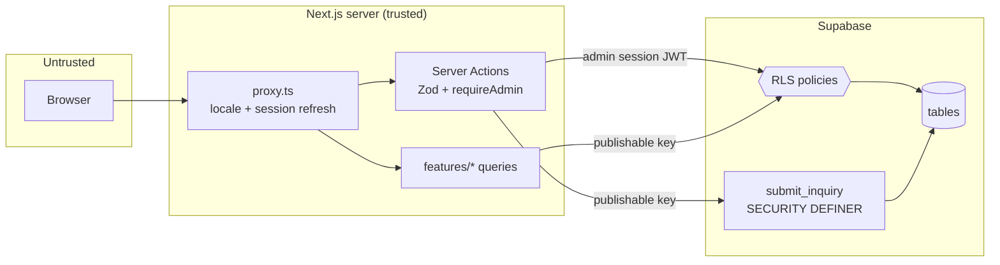

# Security Strategy

## 1. Assets & threats
| Asset | Threats | Primary controls |
|---|---|---|
| Inquiry data (names, emails, phones, messages) | Data leak, scraping, unauthorized access | RLS (no anon read), admin-only DAL, no PII in URLs/logs, retention policy |
| Catalog integrity | Defacement via unauthorized writes | RLS write = `is_admin()`, `requireAdmin()` in actions, audit log |
| Admin accounts | Credential stuffing, session theft | Supabase Auth, MFA, sign-up disabled, httpOnly cookies, rate limits |
| Secrets (keys) | Leak to client bundle / repo / chat | env split, `server-only`, `.gitignore`, no secret key at runtime |
| Forms | Spam, abuse, injection | Zod + DB checks, honeypot, fill-time, ip_hash rate limit, RPC entry point |
| Uploaded images | Malicious files, storage abuse | admin-only, MIME/size allowlist, generated paths |
| Availability | Bot floods | Vercel platform protections, rate limit, cached pages |

Every arrow into Supabase is subject to RLS or a hardened definer function; nothing uses the secret key in request paths.

## 2. Authentication & authorization
- Supabase Auth, email + password for admins; **public sign-ups disabled** (dashboard setting — owner action); TOTP MFA recommended for all admins and required for `owner`.
- Membership: `admin_users` table (not user-editable metadata).
- `requireAdmin()` (DAL) uses `supabase.auth.getUser()` (verifies token with Auth) then `is_admin()`; called at the top of **every** admin page and server action.
- `proxy.ts` only refreshes cookies for `/admin/*`; it is not an authorization layer (Server Functions can bypass matchers).
- Session-dependent UI rendered behind `<Suspense>`; never cached with `'use cache'` (use `'use cache: private'` only if needed).
- Logout clears the session server-side.

## 3. Row Level Security
- Enabled on all `public` tables; per-command policies; see `DATABASE_SCHEMA.md` §5.
- `security definer` functions: `set search_path = ''`, fully-qualified names, minimal grants, input validation inside.
- **RLS test matrix** (run on local stack before each schema PR):

| Case | Expected |
|---|---|
| anon selects unpublished product | 0 rows |
| anon selects `inquiries` | error / 0 rows |
| anon inserts into `inquiries` directly | denied |
| anon calls `submit_inquiry` valid payload | 1 row, reference returned |
| anon calls `submit_inquiry` 6× in 10 min same ip_hash | 6th raises `rate_limited` |
| authenticated non-admin updates product | denied |
| admin updates product | allowed |
| editor deletes inquiry | denied; owner allowed |
| anon uploads to `catalog` bucket | denied |

- Run Supabase security advisors after each migration.

## 4. Input validation & output encoding
- Zod schemas for every server action, search params and route params; reject unknown keys (`.strict()`).
- DB `CHECK` constraints mirror critical limits (defense in depth).
- React escapes output; **no `dangerouslySetInnerHTML`** except JSON-LD serialized with `<` escaped.
- Emails: user input escaped; plain-text part always included; headers never built from raw user input (reply-to validated as email).
- Phone normalization to E.164; emails lower-cased and validated.

## 5. Anti-spam for public forms
1. Honeypot field (visually hidden, `tabindex=-1`, `autocomplete=off`).
2. Signed render timestamp (HMAC with server secret) — reject submissions faster than 3 s or older than 24 h.
3. `ip_hash = sha256(ip ‖ IP_HASH_SALT)` rate limit inside `submit_inquiry`.
4. Idempotent `submission_id` prevents double-submits.
5. Escalation path if spam persists: Cloudflare Turnstile (privacy-friendlier CAPTCHA) — requires approval, consent review.

## 6. Secrets & environment
- `src/lib/env.ts` validates env with Zod; `serverEnv` module imports `server-only`.
- Only `NEXT_PUBLIC_SITE_URL`, `NEXT_PUBLIC_SUPABASE_URL`, `NEXT_PUBLIC_SUPABASE_PUBLISHABLE_KEY` are public.
- `.env*` git-ignored; `.env.example` lists names only.
- QA check: search `.next/static` for secret variable names/values before release.
- Any secret exposed in chat, logs or commits → rotate immediately.

## 7. HTTP security headers (next.config.ts `headers()`)
| Header | Value (initial) |
|---|---|
| `Content-Security-Policy` | `default-src 'self'; img-src 'self' data: https://<project>.supabase.co; connect-src 'self' https://<project>.supabase.co; frame-ancestors 'none'; base-uri 'self'; form-action 'self'` (+ nonce strategy for scripts if needed — verify against Next 16 CSP guide) |
| `Strict-Transport-Security` | `max-age=63072000; includeSubDomains; preload` (production only) |
| `X-Content-Type-Options` | `nosniff` |
| `Referrer-Policy` | `strict-origin-when-cross-origin` |
| `Permissions-Policy` | `camera=(), microphone=(), geolocation=()` |
| `X-Robots-Tag` | `noindex` on preview deployments and `/admin` |

## 8. File uploads (admin)
- Allowed: `image/jpeg`, `image/png`, `image/webp`, `image/avif`; ≤ 5 MB; verify magic bytes server-side, not just the extension.
- Path generated server-side: `products/<productId>/<uuid>.<ext>`; original filename never used.
- SVG uploads **not allowed** (script risk).

## 9. Privacy (Morocco — Loi 09-08, CNDP)
- Consent checkbox + link to privacy policy on every form; consent stored (`consent = true`, timestamp = `created_at`).
- Data minimization: only fields needed to answer the inquiry.
- Retention: define with MSLAB (e.g. closed inquiries purged after N months, spam after 30 days) → scheduled purge.
- CNDP declaration/authorization for processing customer data is an **MSLAB legal responsibility** — flagged, not handled in code.
- No third-party trackers at launch; any analytics must be consent-aware.

## 10. Operational security
- GitHub: branch protection on `main`, required checks, 2FA for maintainers.
- Vercel: deployment protection on previews; separate Supabase project for preview/staging.
- Dependency hygiene: `npm audit` in CI (non-blocking at first), Dependabot/Renovate.
- Backups: Supabase daily backups (plan-dependent) — confirm plan with owner.
