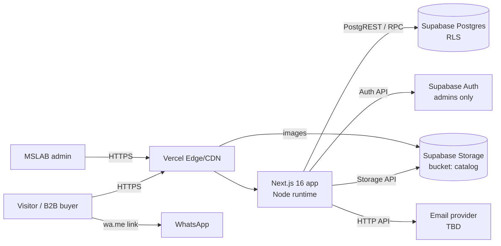
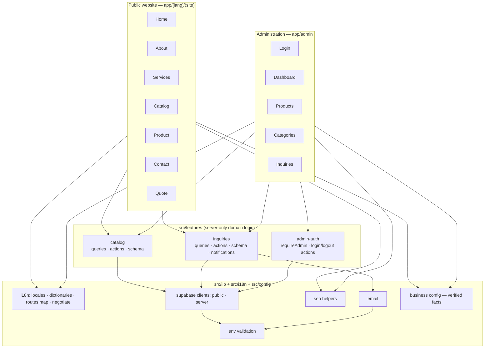
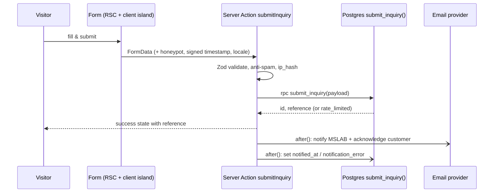

# System Architecture

_Status: proposed (Phase 1). Changes are recorded as ADRs in §8._

## 1. Context

## 2. Module map

Dependency rule: `app → components → (props only)`; `app → features → lib`. `components/ui` never imports `features` or `lib/supabase`. Features never import from `app`.

### A. Public website
| Page | Rendering | Data |
|---|---|---|
| Home | Static shell; featured categories/products cached | `catalog` (cached) + dictionaries |
| About | Static | dictionaries / `config/business.ts` |
| Services (index + detail) | Static | dictionaries (v1); DB-managed later if needed |
| Catalog index, category | Static shell + cached lists; filters via `searchParams` stream in | `catalog` |
| Product | Cached per product + locale | `catalog` |
| Contact, Quote | Static shell + client form island | `inquiries` action |

Services are **content in dictionaries** in v1 (few, rarely changed, need careful translation) — avoids an extra admin module. Revisit if MSLAB wants to edit them.

### B. Product management
Categories (2-level tree), products, per-locale translations, images in Storage, availability enum, search (`pg_trgm` + `tsvector`) and filters (category, availability, brand). Admin CRUD with cache invalidation via `updateTag`.

### C. Customer interaction

WhatsApp: `wa.me` deep links with localized prefilled text; hidden until a verified number exists.

### D. Administration
- Separate root layout `app/admin` (French UI v1; not indexed).
- Supabase Auth email+password (MFA recommended); membership via `admin_users`; `requireAdmin()` in every page and action; `proxy.ts` only refreshes session cookies.
- Modules: dashboard (counts, latest inquiries), products, categories, images, inquiries (status, notes).

### E. Multilingual
`app/[lang]` root layout with `fr | ar | en`, `next/root-params`, JSON dictionaries, typed route map with localized segments resolved by `proxy.ts` rewrites, per-locale DB translations, hreflang per page. Details: `ROUTING_STRATEGY.md`.

## 3. Rendering & caching model (Cache Components)
| Data | Mechanism | Invalidation |
|---|---|---|
| Dictionaries | static import, server-only | deploy |
| Catalog lists/details | `'use cache'` + `cacheLife('hours')` + `cacheTag('catalog', 'product:<id>', 'category:<id>')` using cookie-less client | `updateTag` from admin actions |
| Search results | `'use cache'` keyed by validated params, short `cacheLife` | `catalog` tag |
| Admin data | uncached, session-bound client, behind `<Suspense>` | n/a |
| Inquiry submit | Server Action (no cache) | n/a |

Rule: anything reading `cookies()`/`headers()` stays out of `'use cache'` and inside `<Suspense>`.

## 4. Error handling & loading
- Expected errors → typed action results rendered in UI.
- Unexpected → `error.tsx` per segment (`[lang]/(site)`, `admin`) and `catchError` around risky islands; `global-error.tsx` at root.
- `not-found.tsx` localized; `notFound()` for unknown slugs/locales.
- `loading.tsx` / `<Suspense>` skeletons sized to content.
- Server logs: structured `console.error` with an error id (Vercel logs); no PII in logs.

## 5. Technology decisions
| Decision | Why it fits MSLAB | Alternatives rejected |
|---|---|---|
| **Next.js 16 App Router (existing)** | Already scaffolded; RSC + static shells give fast pages on mobile networks; built-in metadata/sitemap for SEO | — |
| **Keep Cache Components on** | Static shell + cached catalog = fast, cheap; tag-based invalidation fits admin edits | Disabling it (loses instant navigation, simpler but slower) |
| **TypeScript strict (existing)** | Safety for a small team; generated DB types end-to-end | — |
| **Tailwind 4 (existing)** | Logical utilities + `rtl:` variant make RTL straightforward; no runtime CSS | CSS-in-JS (runtime cost), component kits (heavy, harder RTL) |
| **No UI component library** | Small, branded surface; full RTL/a11y control; less JS | shadcn/ui (acceptable later for admin if speed needed — ADR) |
| **Built-in i18n (no library)** | Docs-endorsed pattern; 3 locales; works natively with `root-params` and Cache Components; zero bundle cost | next-intl (good, but adds a dependency and its own routing layer to keep compatible with Next 16 features) |
| **Supabase Postgres + RLS** | Managed Postgres, Storage and Auth in one place; RLS gives defense in depth; free tier fits launch | Firebase (no SQL/relations), custom backend (more ops) |
| **Supabase Auth for admins only** | No public accounts needed; few staff users | Clerk/Auth.js (extra vendor) |
| **Supabase Storage for images** | Same RLS model (`is_admin()`), CDN-backed public bucket, `next/image` optimization | Vercel Blob (second vendor), Cloudinary (cost) |
| **Server Actions for mutations** | Progressive enhancement, no API surface to secure separately | REST route handlers (more code) |
| **`submit_inquiry` SECURITY DEFINER RPC** | Public inserts without exposing tables or using the service key; atomic inquiry + items; DB-side rate limit | Service-role key in server action (larger blast radius) |
| **Zod** | One schema for client hints and server validation; already transitively present | Valibot (smaller, but less familiar), hand-written checks |
| **Email via provider HTTP API + `after()`** | Lead persisted first; no SDK required | DB webhook → Edge Function (more moving parts; possible later) |
| **Vercel** | First-class Next.js 16 support (Cache Components, previews) | Self-hosting (more ops) |
| **GitHub + PR previews** | Review + preview per change | — |

## 6. Dependency register
| Package | Status | Purpose | Phase |
|---|---|---|---|
| `next`, `react`, `react-dom`, `tailwindcss`, `@tailwindcss/turbopack`, `typescript`, `eslint`, `eslint-config-next`, `@types/*` | installed | framework & tooling | — |
| `@supabase/supabase-js` | planned | DB/Storage/Auth client | 3 |
| `@supabase/ssr` | planned | cookie-based admin session | 5 |
| `zod` | planned (direct) | validation | 2 |
| `server-only` | planned | guard server modules | 2 |
| `@playwright/test` | planned (dev) | E2E | 2 |
| `supabase` CLI | planned (dev, via npx) | local stack, migrations, types | 3 |
| `prettier` + `prettier-plugin-tailwindcss` | optional (dev) | formatting / class sorting | 2 |
| Email SDK | **not planned** | use `fetch` to provider API | — |
| i18n library, UI kit, state manager, form library, `clsx`/`tailwind-merge`, `negotiator` | **not planned** | covered by platform features | — |

## 7. Development standards (summary — full rules in `CLAUDE.md`)
Clean module boundaries; reusable primitives; strict TS; Server Components by default; server-side data access only; RLS everywhere; Zod at every boundary; typed results; Suspense/skeletons; WCAG 2.2 AA; mobile-first + RTL logical utilities; per-page localized metadata; Core Web Vitals budgets; env validation with server/public split; feature branches + Conventional Commits + PR checks.

## 8. Architecture Decision Records
| # | Date | Decision | Status |
|---|---|---|---|
| ADR-001 | 2026-11-14 | Keep `cacheComponents` + `partialPrefetching` enabled | Accepted |
| ADR-002 | 2026-11-14 | Built-in i18n with `app/[lang]` + `root-params`, no i18n library | Proposed |
| ADR-003 | 2026-11-14 | Localized URL segments via typed route map + proxy rewrites | Proposed (Arabic segment script open) |
| ADR-004 | 2026-11-14 | Two root layouts: `app/[lang]` (public) and `app/admin` (back office) | Proposed |
| ADR-005 | 2026-11-14 | Public inquiries only via `submit_inquiry` SECURITY DEFINER RPC | Proposed |
| ADR-006 | 2026-11-14 | ~~Services content in dictionaries for v1~~ → superseded by ADR-012 | Superseded |
| ADR-007 | 2026-11-14 | No public prices in catalog until MSLAB defines policy | Accepted |
| ADR-008 | 2026-11-14 | Email provider TBD; integrate via HTTP API in `after()` behind a provider-agnostic interface (dev driver logs only) | Accepted (provider open) |
| ADR-009 | 2026-11-14 | Table names follow the Phase 2 brief: `admin_profiles`, `categories`, `products`, `product_images`, `services`, `inquiries` (contact only), `quotation_requests`, `quotation_items`, plus `site_settings` | Accepted |
| ADR-010 | 2026-11-14 | Localized content stored as per-locale columns (`name_fr` required, `name_ar`/`name_en` optional, per-locale slugs) instead of translation tables; public fallback to French | Accepted |
| ADR-011 | 2026-11-14 | Product lifecycle `status` = `draft \| published \| archived`; availability removed from MVP (never invented) | Accepted |
| ADR-012 | 2026-11-14 | Services are DB-managed with admin CRUD | Accepted |
| ADR-013 | 2026-11-14 | Separate status vocabularies: quotations `new, in_review, contacted, quoted, accepted, rejected, closed`; contact inquiries `new, read, replied, closed, spam` (+ `read_at`) | Accepted |
| ADR-014 | 2026-11-14 | Company details live in a `site_settings` singleton editable in `/admin/settings`; empty fields are hidden publicly | Accepted |
| ADR-015 | 2026-11-14, revised 2026-11-16 | Admin UI in French, English or Arabic (RTL), chosen per admin from the sidebar/login page and stored in the `mslab-admin-lang` cookie. Text lives in `src/features/admin/dictionary.ts`; server actions keep returning French messages, translated for display by `translateMessage`. Arabic input fields render `dir="rtl"` | Accepted |
| ADR-016 | 2026-11-14 | i18n routing built in Milestone 1 (not M7); database (M2) precedes catalog (M3) | Accepted |
| ADR-017 | 2026-11-14 | Multi-product quotes use a client-side "quote list" (localStorage) feeding the quotation form — not a cart, no checkout | Accepted |
| ADR-018 | 2026-11-14 | "Ink & paper" palette as semantic tokens; Geist (Latin) + IBM Plex Sans Arabic | Accepted |
| ADR-021 | 2026-11-15 | Print on demand: custom requests reuse `quotation_requests` (`kind = custom`) + `custom_request_details`; visitor files upload **directly from the browser** to the private `custom-uploads` bucket with a single-use, rate-limited upload ticket (no Vercel 4.5 MB body limit, no service-role key); materials/finishes and the portfolio are admin-managed; order tracking = reference + e-mail through a rate-limited RPC, history in `quotation_status_events` | Accepted |
| ADR-020 | 2026-11-14 | Production database on the Supabase **Free** plan (owner decision); mitigations: daily keep-alive workflow, manual backup routine, usage monitoring | Accepted |
| ADR-019 | 2026-11-14 | Original SVG logo (folded sheet + "M" monogram, ink/cyan) created at the owner's request; used in header, footer, admin and favicon | Accepted (approved by the owner 2026-11-14; trademark check recommended before print use) |
| ADR-024 | 2026-11-18 | Legal documents are versioned TypeScript content in `src/content/legal/` (fr/ar/en, `status: draft | validated`, `version`, `lastUpdated`), rendered by `components/legal/`. Unverified facts are `{ph:key}` placeholders shown as visible « à compléter » markers; company facts come from `site_settings` via `{fact:key}`. Drafts are noindex and excluded from the sitemap. Admin-entered legal notice / privacy text (ADR-014) still overrides per locale. Cookie consent: first-party `mslab_consent` cookie (6 months, versioned); Google Tag Manager is injected only after analytics opt-in, with Consent Mode ad storage denied; withdrawal deletes `_ga*` cookies | Accepted (owner approval 2026-11-18; texts pending legal review) |
| ADR-025 | 2026-11-18 | Legal values (RC, ICE, CNDP reference, retention periods, payment / delivery / returns terms…) are entered in `/admin/settings` → « Informations légales » and stored in `site_settings.legal_facts` (jsonb, migration `20261118120000`). Public legal pages never show a placeholder: a clause written as an optional `[[…]]` segment is removed while its value is empty (`content/legal/resolve.ts`), table/label rows are hidden, empty sections disappear. Unit tests enforce that running text only uses values inside optional segments | Accepted (owner request 2026-11-18) |
| ADR-026 | 2026-11-18 | MSLAB Studio editor (docs/STUDIO.md): layers per printable side, direct manipulation, undo/redo, in SVG + Canvas 2D (no dependency). Product photos, print areas and options come only from MSLAB (studio_products / studio_views / studio_options, admin-managed); otherwise placeholder visuals with no specification. Three outputs: live preview, PNG mockup (role mockup), original files (role artwork) + design spec in custom_request_details.design. File types identified from bytes (editor, uploader, admin). AI-generated mockup renders removed (owner decision A2) | Accepted (owner approval 2026-11-18) |
| ADR-028 | 2026-11-27 | Business Management module in `/admin/business/*` (docs/BUSINESS_MANAGEMENT.md): Gérant / Associé roles on the ADR-027 permission model; staff-only tables for products & stock ledger, customers, sales & payments, expenses, daily journal; money and stock changed only by SECURITY DEFINER RPCs (row locks, `client_key` idempotency, no negative stock without permission, void/cancel with reason instead of delete); private bucket `business-files`; public catalogue untouched | Accepted (owner brief 2026-11-27) |
| ADR-027 | 2026-11-22 | Internal ERP inside the existing `/admin` (docs/ERP_ARCHITECTURE.md): role/permission model on top of `admin_profiles` (`private.can*`, MFA kept), existing requests become CRM intake, internal data only in staff-only sibling tables (public tables untouched), stock and money changed only through transactional RPCs over an append-only ledger, generic audit log, phased delivery starting with permissions + migration-drift reconciliation | Proposed |

> **Phase 2 note:** ADR-009 to ADR-014 change the data model described in `DATABASE_SCHEMA.md`. That document is rewritten together with the migrations in Milestone 2; where it conflicts with these ADRs, the ADRs win.
